<div align="center">

# 🖨️ Druckwerk

[English](README.md) · **Deutsch**

**Eine Filament-Bibliothek, die sich selbst pflegt, dazu deine 3D-Modelle, Drucker und Druckverlauf, direkt im Heimnetz.**

Selbst gehostet · ein Container · SQLite · keine Cloud, kein Konto

[](LICENSE)
[](https://nodejs.org)
[](https://react.dev)
[](https://threejs.org)
[](https://nodejs.org/api/sqlite.html)
[](compose.yaml)
[](#)

[Schnellstart](#-schnellstart) · [Funktionen](#-funktionen) · [Drucker](#-drucker-und-integrationen) ·
[Konfiguration](#%EF%B8%8F-konfiguration)

<picture><source media="(prefers-color-scheme: dark)" srcset="docs/images/regal-animation-dunkel.webp">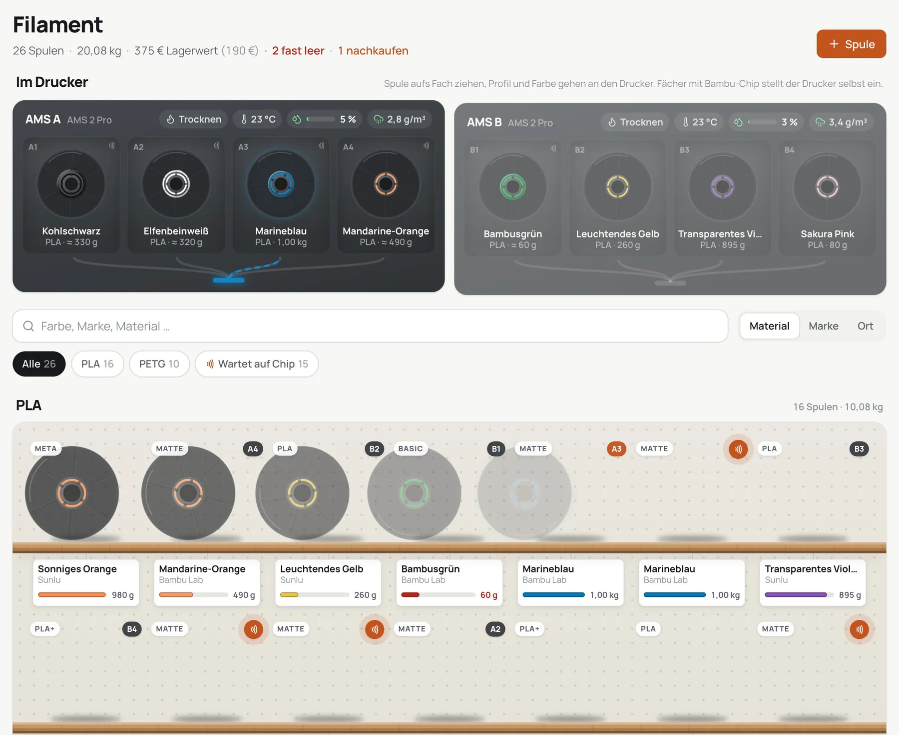</picture>

<picture><source media="(prefers-color-scheme: dark)" srcset="docs/images/drucker-dunkel.webp">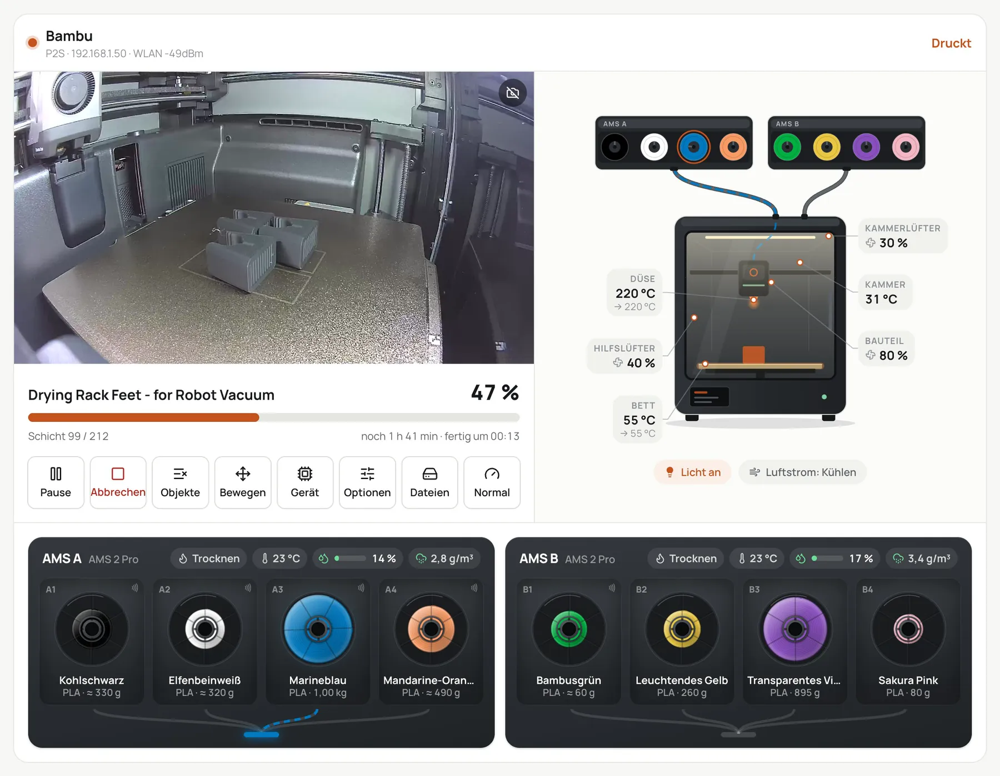</picture>

</div>

Jede Spule, die du hast, steht im Regal, das AMS direkt darüber. Bambu-Spulen melden sich per Chip selbst an, jeder Druck
bucht seine Gramm von der Spule ab, die wirklich im Fach lag, und Einlegen heißt: Spule aufs Fach ziehen. Du weißt immer,
was noch da ist, was es gekostet hat und was nachbestellt werden muss, ohne Tabelle und ohne Cloud.

Drumherum ist Druckwerk der Rest deines Drucker-Setups: eine Bibliothek für deine Modelle mit 3D-Vorschau, Slicen in der App
mit den offiziellen Bambu-Profilen, Druckstart direkt auf dem Drucker, Live-Status mit Kamera und ein Verlauf mit Foto jeder
Platte. Für die Feinarbeit bleibt Bambu Studio. Alles bleibt in deinem Netz.

## Inhalt

- [Highlights](#-highlights)
- [Funktionen](#-funktionen)
- [Drucker und Integrationen](#-drucker-und-integrationen)
- [Unter der Haube](#-unter-der-haube)
- [Schnellstart](#-schnellstart)
- [Konfiguration](#%EF%B8%8F-konfiguration)
- [Sicherung](#-sicherung)
- [Entwickeln](#-entwickeln)
- [Datenschutz](#-datenschutz)
- [Lizenz](#-lizenz)

## ✨ Highlights

- 🧵 **Ein Filamentregal, das sich selbst pflegt**: jede Spule auf Holzbrettern, mit Füllstand, Preis und Lagerwert
- 🏷️ **Bambu-Spulen melden sich selbst an**: Chip im AMS gelesen, Spule mit offiziellem Farbnamen angelegt. Spulen aus einer
  Bestellung warten im Vakuumbeutel, bis ihr Chip auftaucht
- ⚖️ **Jedes Gramm gebucht**: Verbrauch je Druck aus dem Slice, von der Spule, die im Fach lag, auch bei Drucken aus Bambu Studio
- 🖱️ **Spule aufs AMS-Fach ziehen**: Profil, Farbe und Düsentemperaturen gehen an den Drucker
- 🎨 **Farbkatalog** für Bambu Lab, Sunlu, eSUN, Polymaker, Prusament, Extrudr, Elegoo und mehr, dazu Link-Import aus jeder Shopseite
- 📊 **Kennwerte und Preis-Leistung**: Datenblattwerte an gedruckten Probekörpern und Shoppreise je kg im Vergleich
- 📡 **Der Drucker, live und in der Hand**: Zeichnung des Druckers mit Temperaturen, Lüftern und Luftstrom am Bauteil, Kamera,
  Pause, Abbruch, Licht, Geschwindigkeit, Heizen, Achsen bewegen, Druckoptionen und KI-Erkennung, direkt über das LAN
- 💧 **AMS im Griff**: laden, entladen, Chip neu lesen, trocknen mit Temperatur und Dauer oder automatisch, wenn die Feuchte steigt
- 🔪 **Slicen in der App** mit Bambu Studio und den offiziellen Profilen: Zweck, Qualität, Düse, Wände, Füllung und Anzahl
  wählen, Gramm je Spule und Druckzeit live sehen, bevor du druckst
- 📚 **Eine Bibliothek für alle Modelle**: STL, 3MF, OBJ, STEP und geslicte `.gcode.3mf` mit 3D-Vorschau, dazu Tabs für
  **Printables und MakerWorld** zum Suchen und direkt Drucken
- ▶️ **Drucken mit einem Klick**: Platte wählen, Filamente den AMS-Fächern zuordnen, los
- 📋 **Druckwarteschlange**: geslicte Platten einreihen; nach Druckende kommt eine Meldung zum Bett räumen, der nächste Druck
  startet über den gewohnten Druckdialog mit frischer AMS-Zuordnung
- 📸 **Ein Verlauf, der sich selbst schreibt**: jeder Druck mit Foto der Platte, Verbrauch, Sternen und Notiz
- 🛟 **Alle Fehlercodes auf Deutsch**: rund 1.900 HMS-Meldungen und 480 Druckfehler, offline
- 💶 **Was ein Druck wirklich kostet**: Filament von der Spule plus Strom, gemessen per Shelly- oder Tasmota-Steckdose oder geschätzt
- 🔔 **Benachrichtigungen** über ntfy, Gotify oder Webhook (Home Assistant): Druck fertig mit Foto, Fehler, Spule fast leer,
  feuchtes AMS, Wartung fällig
- 🗂️ **Jeder Druck archiviert**: Dateien von Drucken aus Bambu Studio landen in der Bibliothek, mit „Nochmal drucken“ und Zeitraffer
- 🌗 **Hell und dunkel**, vom iPhone bis zum 16"-MacBook
- 🔒 **Alles bleibt bei dir**: ein Container, eine SQLite-Datei, ein Datenordner

## 🧩 Funktionen

### Filamentregal
Das Herz der App. Spulen rollen ins Regal, heben und drehen sich beim Drüberfahren, und die Spule, aus der gerade gedruckt
wird, dreht sich im AMS-Fach, während der Faden zum Drucker läuft.

- Alle Spulen auf Holzbrettern, gruppiert nach Material, Marke oder Ort, mit Füllstand, Preis und Lagerwert
- Oben sitzen die AMS-Fächer: **Spule aufs Fach ziehen** legt sie ein, Profil, Farbe und Düsentemperaturen gehen an den
  Drucker. Ablegen auf ein belegtes Fach tauscht. Am Touchscreen startet ein langer Druck das Ziehen
- **Bambu-Spulen mit Chip** legt die App beim Einlegen selbst an, mit offiziellem deutschem Farbnamen. Vorab angelegte Spulen
  aus einer Bestellung warten im Vakuumbeutel („Wartet auf Chip“) und übernehmen den Chip, sobald er zum ersten Mal gelesen wird
- **Füllstand**: Chip-Spulen folgen dem AMS, jeder Druck bucht sein Filament aus den Gramm je Filament im Slice ab,
  abgebrochene Drucke nach Fortschritt. Das klappt auch für Drucke, die in Bambu Studio gestartet wurden
- **Fremdspulen** bekommen einen Startwert (Gramm oder voll, ¾, ½, ¼) und lassen sich mit der Küchenwaage nachwiegen
- **Druckprofile** wählt die App passend zu Material und Sorte (Matte, Silk, CF …), auch für Fremdfilament

| Hell | Dunkel |
|---|---|
| 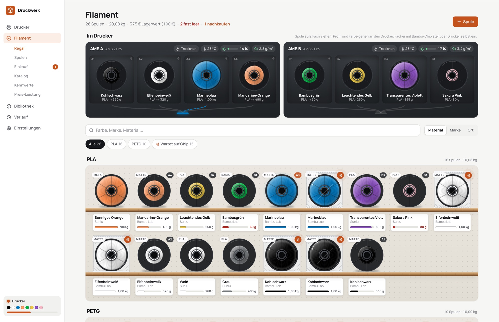 | 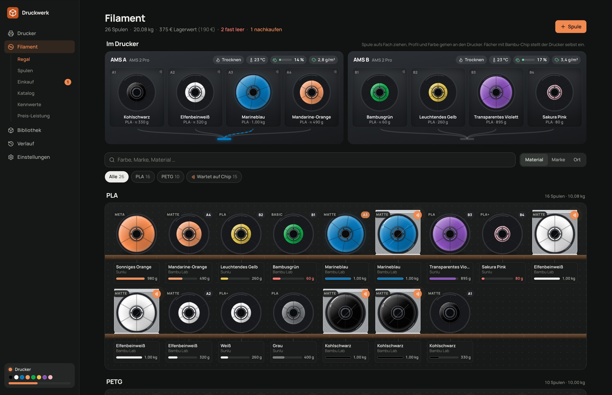 |

### Spulen
- Marke, Sorte, Farbe aus dem Katalog, Gewichte, Preise mit Rabatt, Druckprofil mit Temperaturen und Trocknung
- **Link-Import**: Produktlink einfügen, die Anthropic-API liest die Shopseite und füllt alles aus (optional, eigener API-Key)
- Die Liste „Spulen“ zeigt alle Spulen als Tabelle: Hex, Profil, Düse, Ort, Chip-Status, Preis je Kilo, zuletzt genutzt
  und Rest, sortierbar, auf schmalen Bildschirmen mit weniger Spalten

| Spulendialog | Spulenliste |
|---|---|
| 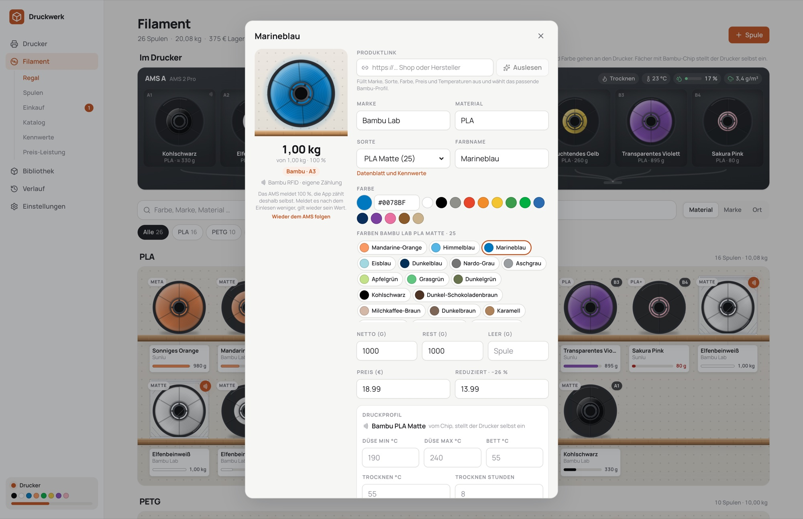 | 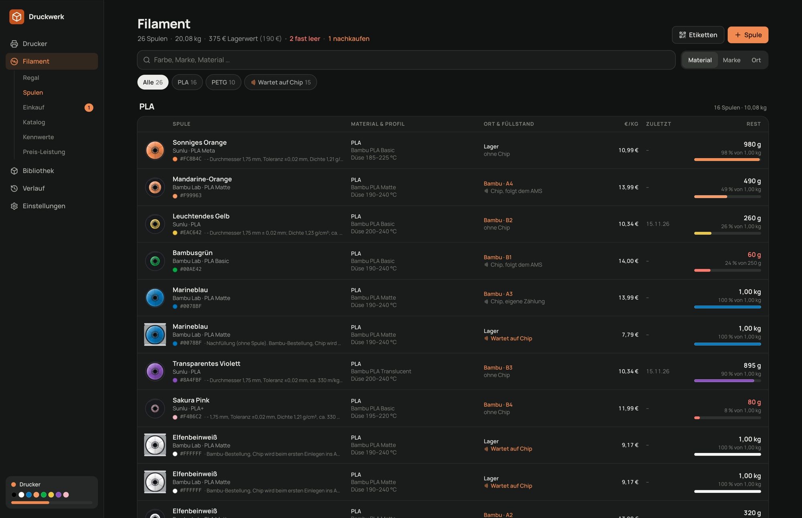 |

### Farbkatalog
- Alle Sorten und Farben von **Bambu Lab** (aus Bambu Studio, mit deutschen Namen und Chip-Codes), **Sunlu** und **eSUN** (aus
  ihren Farbtabellen), dazu **Polymaker**, **Prusament**, **Extrudr**, **Elegoo**, **Anycubic**, **Overture**, **Das Filament** und
  **3DJake** aus [SpoolmanDB](https://github.com/Donkie/SpoolmanDB)
- Suche über alle Farben, Hex und Herstellercode
- Nur Farben mit belegtem Hex-Wert; einzelne sind in den Farbtabellen der Hersteller nachrecherchiert, der Rest fehlt, statt geraten zu werden.
  Eigene Marken, Sorten und Farben anlegen und ändern. Jede Markenkarte verlinkt auf den Shop

| Hell | Dunkel |
|---|---|
| 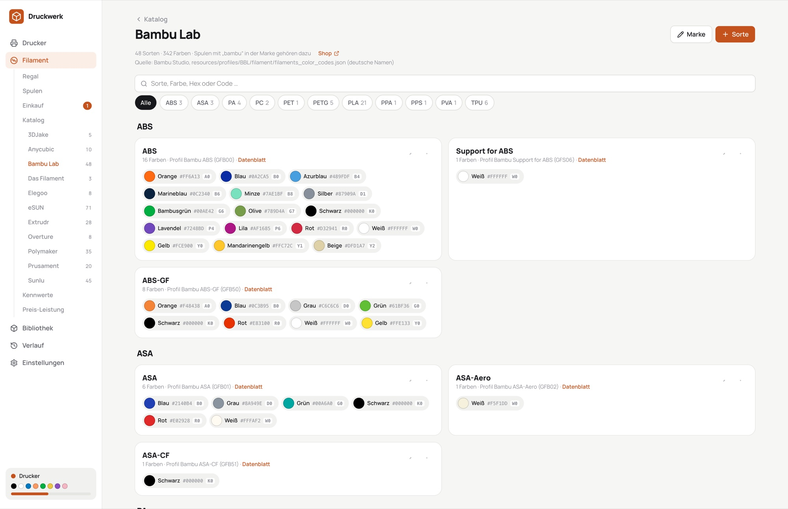 | 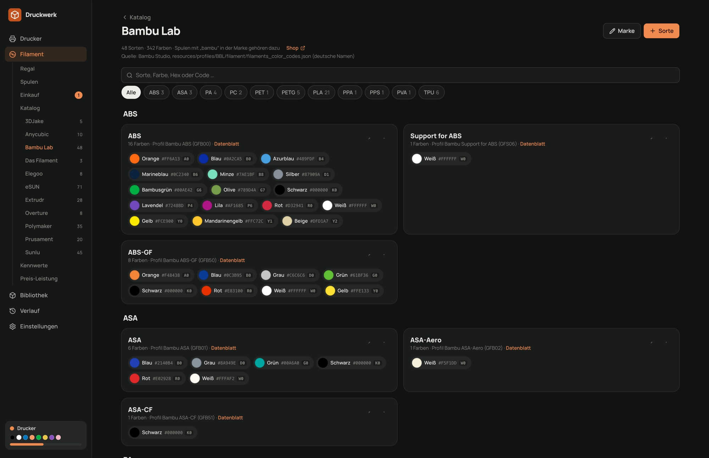 |

### Preis-Leistung
- Shoppreise der gängigen Sorten (PLA, PLA+/Pro, Matte, Silk, High Speed, PETG) aus den offiziellen Shops für Deutschland, einmal recherchiert
  und mit Datum hinterlegt
- Je Gruppe eine Preisleiste und eine Rangliste je kg, daneben Zugfestigkeit und Wärmeformbeständigkeit aus dem Datenblatt; eigene Sorten
  oben mit Platz, günstigster Alternative und dem selbst gezahlten Preis

### Kennwerte
- Datenblatt-Seite für fast jede Katalogsorte, aus dem technischen Datenblatt des Herstellers (verlinkt): Wärmeformbeständigkeit
  (HDT bei 0,45 und 1,8 MPa), Vicat, Glasübergang und Schmelzpunkt auf einer Temperaturskala neben Düsen-, Bett- und
  Trocknungstemperatur, Zug-, Biege- und Schlagversuch als kleine Zeichnungen, Dichte, Härte und Schmelzindex, je mit Prüfnorm
- Nur Werte an gedruckten Probekörpern, damit Sorten fair vergleichbar sind (spritzgegossene Stäbe liegen 20–50 % höher).
  Jeder Wert mit Rang im Material und über alle Sorten
- Materialseiten (PLA, PETG, PA …) mit Medianen und Spannen, eine Vergleichsseite reiht alle Sorten und Materialien je Kennwert,
  auf Wunsch nur die aus dem Regal. Spulendialog und Katalog verlinken aufs Datenblatt

| Preis-Leistung | Kennwerte |
|---|---|
| 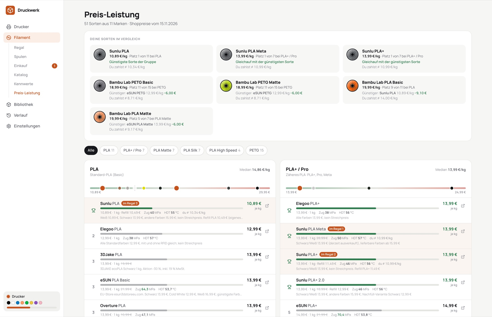 | 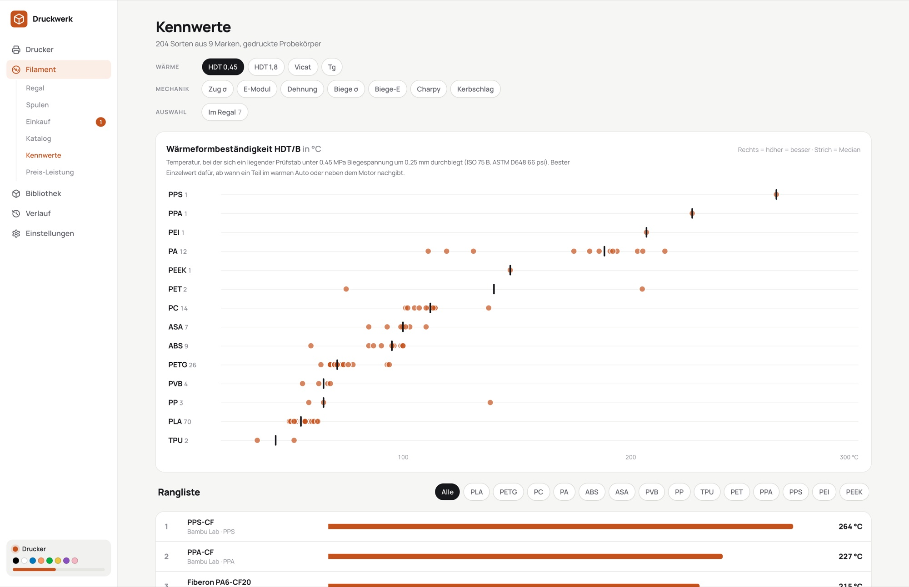 |

### Drucker-Dashboard
- Status, Fortschritt, Schicht, Restzeit und Uhrzeit des Druckendes, Düse, Bett und Kammer
- **Zeichnung deines Druckers** (P2S): fahrender Druckkopf, wachsendes Objekt, Düse, Bett, Kammer und jeder Lüfter als Schild
  direkt am Bauteil, Licht und Luftstrom. Oben alle AMS mit eigenem Schlauch, das aktive Fach färbt Schlauch und Faden bis in
  den Druckkopf
- **Live-Kamera** (A1, P1 über TLS, X1, H2 und P2S über RTSPS)
- **Pausieren, fortsetzen, abbrechen**, Licht schalten, Geschwindigkeit wählen (leise, normal, Sport, rasend), **Objekte
  überspringen** im laufenden Druck auf einem Bild der Platte
- Düse und Bett **heizen**, **Lüfter** und **Luftstrom** (Kühlen, Heizen, volle Kühlung) einstellen, **Achsen bewegen**,
  Referenzfahrt und Extruder
- **Druckoptionen und KI-Erkennung** (Spaghetti, Abfallschacht, Klumpen an der Düse, erste Schicht, Druckplatte, Fremdkörper,
  Tür offen während des Drucks …), nur was dein Drucker meldet
- **Gerät**: Firmware aller Module, Düsendurchmesser und -art, Speicher; Bett-, Vibrations- oder Motorgeräusch-Kalibrierung starten
- **Dateien auf SD-Karte bzw. USB-Stick**: auflisten, drucken, in die Bibliothek holen oder löschen
- Meldet der Drucker ein Problem (HMS), steht es auf Deutsch da, mit Link ins Bambu-Wiki; Druckfehler quittieren,
  HMS-Meldungen ausblenden, bis der Drucker sie fallen lässt. Zeiten der Meldungen stimmen auch, wenn die Druckeruhr in der
  falschen Zeitzone läuft
- **AMS-Einheiten, wie sie im Drucker stehen**: Feuchte (relativ und absolut in g/m³ mit Skala) und Temperatur je Einheit,
  jedes Fach mit Farbe, Name und Rest. Aus dem aktiven Fach dreht sich die Spule und der Faden läuft zum Drucker
- **Laden, entladen, Chip neu lesen, trocknen** mit Temperatur und Dauer. Auto-Trocknen startet, wenn die Feuchte über eine
  Grenze steigt, nie während eines Drucks, und prüft, ob das AMS wirklich trocknet. AMS-Einstellungen (Chip beim Einlegen
  bzw. Einschalten lesen, Restmenge schätzen) und automatischer Spulenwechsel

| Achsen bewegen | Druckoptionen |
|---|---|
| 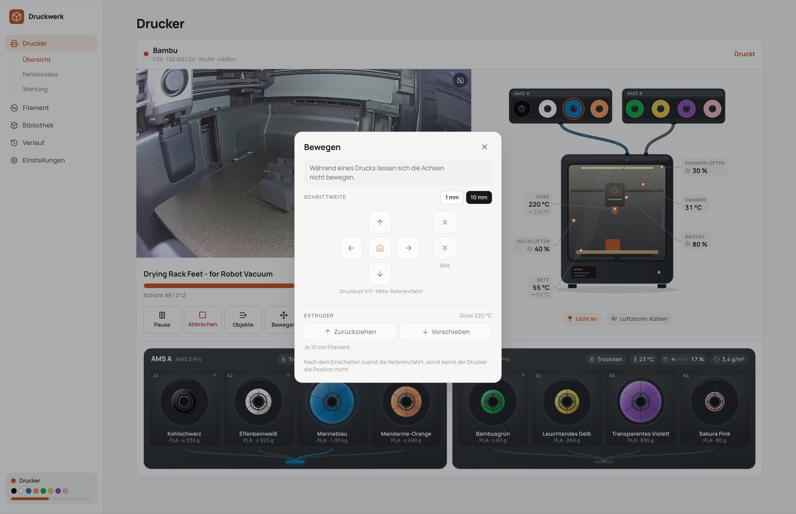 | 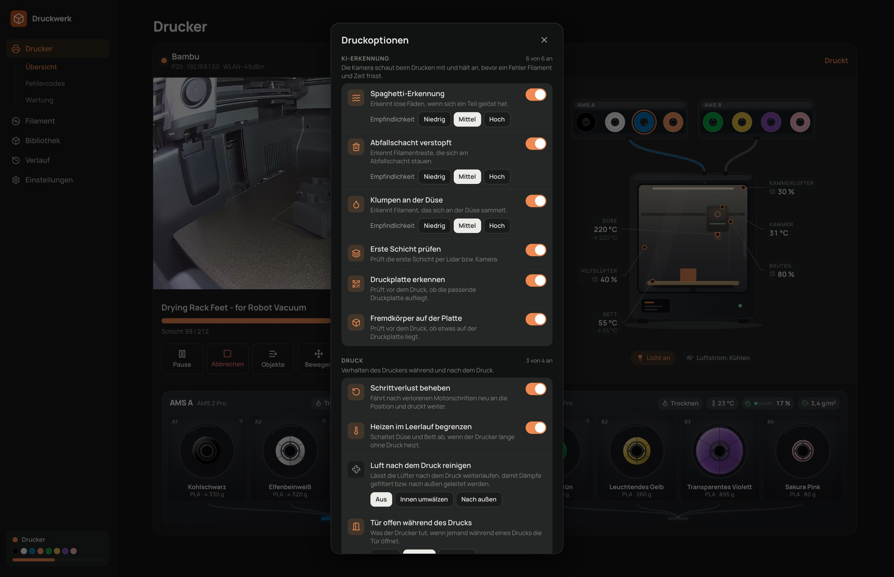 |

### Modell-Bibliothek
- Modelle mit beliebig vielen Dateien: STL, 3MF, OBJ, STEP, geslicte `.gcode.3mf`, Bilder und mehr
- **Dateien auf die Seite ziehen**, jede ZIP wird ein eigenes Modell
- Vorschaubilder rendert der Browser selbst, geslicte Dateien bringen ihre Plattenbilder mit
- Tags, Favoriten, Suche und Filter „druckbereit“
- Modellseite mit **drehbarer 3D-Vorschau** und Maßen, allen Dateien, Beschreibung, Quelle, Lizenz und jedem Druck des Modells
- Geslicte Dateien nennen Druckzeit, Gewicht und Filamente je Platte. „In Bambu Studio öffnen“ übergibt eine Datei zum Slicen

| Bibliothek | Modell |
|---|---|
| 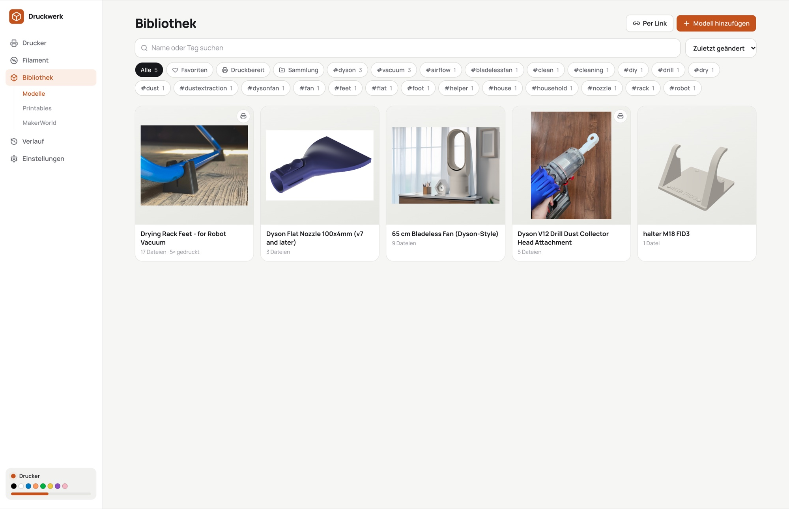 | 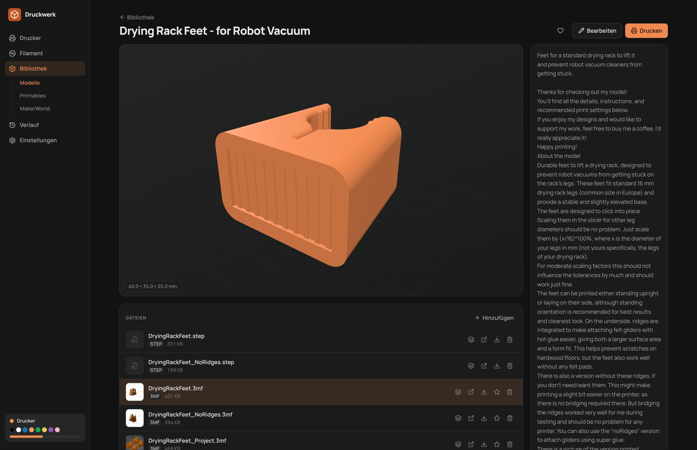 |

- **Sammlungen** fassen Modelle zu Projekten zusammen, ein Modell kann in mehreren stehen
- **Import per Link**: Ein Printables-Link bringt Name, Beschreibung, Designer, Lizenz, alle Dateien und die Bilder, ohne Konto.
  Ein MakerWorld-Link bringt Angaben und Bilder, mit angemeldetem Bambu-Konto auch die 3MF des Standardprofils. Andere Seiten
  bringen Angaben und Bilder über die Anthropic-API, die Dateien legst du selbst ab. Designer, Lizenz und Titel liest die App
  dann aus der 3MF
- Ein Link, der schon in der Bibliothek steht, öffnet das vorhandene Modell statt einer Kopie
- **Printables-Tab** neben der Bibliothek: Printables durchsuchen und sortieren, Bilder und Dateien ansehen, **ein Modell mit
  zwei Klicks drucken** wie in Bambu Handy (es landet in der Bibliothek, wird im Server geslict, dann öffnet der Druckdialog),
  eine Datei direkt in OrcaSlicer öffnen, herunterladen (Bambu Studio nimmt nur Links von MakerWorld an) oder das ganze Modell
  übernehmen
- **MakerWorld-Tab**: MakerWorld durchsuchen, jedes Druckprofil mit Drucker, Zeit, Gramm und Filamentfarben (Profile für den
  eigenen Drucker zuerst), ein Profil drucken oder seine 3MF in die Bibliothek legen. Suchen geht ohne Konto, die Dateien
  brauchen einmal die Anmeldung mit deinem Bambu-Konto (Mail und Passwort oder Code per Mail; gespeichert wird nur das Token)

### Drucken
- Geslicte `.gcode.3mf` startet die App direkt
- **Slicen in der App** („Slicen und drucken“) für STL, 3MF, OBJ und STEP: Der Server slict mit der Kommandozeile von
  Bambu Studio (Open Source, auf ARM OrcaSlicer) und den offiziellen Bambu-Lab-Profilen deines Druckers und deiner Düse. Qualität,
  Druckplatte, Filament je AMS-Fach (Profil und Farbe aus dem Fach), Stützen (aus, normal, Baum), Füllung, Brim, Auto-Ausrichten
  und bei mehreren Farben die Spülmenge je Farbwechsel (100 % wie Bambu Studio, 75 % oder 50 %); eine 3MF behält ihre Objekte und
  Farben. **Mehrere Exemplare** auf einmal: Der Slicer ordnet sie auf dem Bett an. Die Vorschau zeigt das Modell auf deiner
  Druckplatte (strukturierte PEI, glatte PEI usw.) genau dort, wo der Slicer es hinlegt. Die geslicte Datei liegt danach beim
  Modell und geht direkt in den Druck. Braucht `SLICER=1`
- **Hilfe zu jeder Wahl**, je mit kleiner Zeichnung: Zweck (Funktionsteil, Sichtteil, Schnell) stellt Schichthöhe, Wände und
  Füllung passend zur Düse ein; Düse mit der wirklich eingebauten und Warnung bei CF/GF ohne gehärtete Düse; Wände, Stützen,
  Füllmuster in der Draufsicht
- **Live-Vorschau**: Kurz nach jeder Änderung slict der Server im Hintergrund und zeigt Gramm je Spule mit Rest danach und die
  Druckzeit, dazu den Unterschied zum Standardprofil („+13 min +5,4 g“)
- **Projekte mit Platten** (Bambu Studio, MakerWorld): eine Platte oder alle wählen, die Anordnung des Autors bleibt. Projekte für
  ein größeres Bett (H2S auf P2S) rückt die App Platte für Platte auf dein Bett
- Platte wählen, **Filamente den AMS-Fächern zuordnen** per Klick auf die Spulen in den AMS-Kästen (vorbelegt nach Material und
  Farbe), Zeitraffer, Bett nivellieren und Flussrate kalibrieren als aus, auto oder immer wie in Bambu Studio, mit Zeichnung und
  Empfehlung
- Die Datei geht per FTPS auf SD-Karte bzw. USB-Stick des Druckers
- **Druckwarteschlange**: geslicte Platten für einen Drucker oder den ersten freien einreihen, Reihenfolge ändern, jeden Druck
  über den Druckdialog mit frischer AMS-Zuordnung starten. Kein Autostart: Nach Druckende kommt erst die Meldung, das Bett zu räumen
- **„In Orca öffnen“** übergibt jede Datei an OrcaSlicer auf deinem Rechner, für alles, was der Dialog nicht abdeckt

| Slicen | Druckdialog |
|---|---|
| 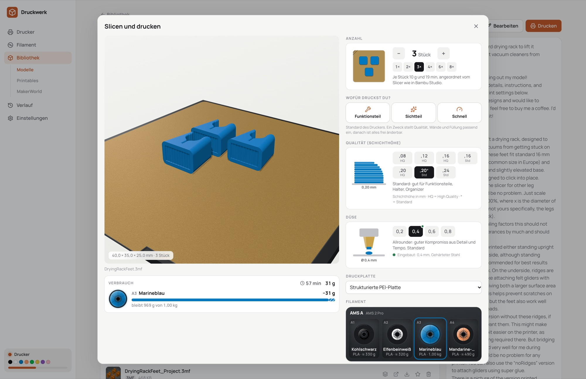 | 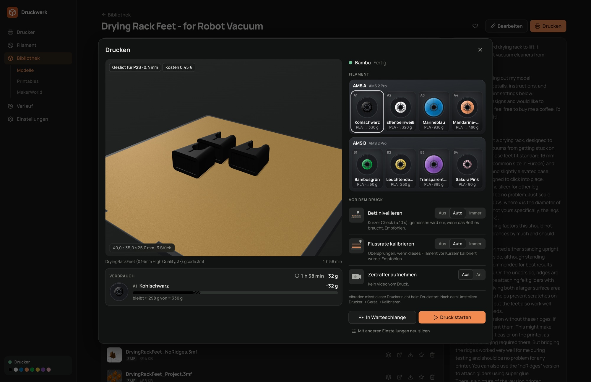 |

### Verlauf
- Jeder Druck kommt automatisch in den Verlauf, auch aus Bambu Studio oder vom Drucker selbst, und wird dem Modell zugeordnet
- Am Ende jedes Drucks ein **Foto der Platte**
- Sterne und Notiz je Druck, Fehler mit Code und Klartext
- Oben Anzahl, Druckzeit und Erfolgsquote
- Drucke ohne lesbare Datei (P2S ohne SD-Karte bzw. USB-Stick, Cloud-Drucke) bekommen **„Verbrauch nachtragen“**: Gramm je Spule
  von Hand buchen oder aus einer exportierten `.gcode.3mf` lesen

| Hell | Dunkel |
|---|---|
| 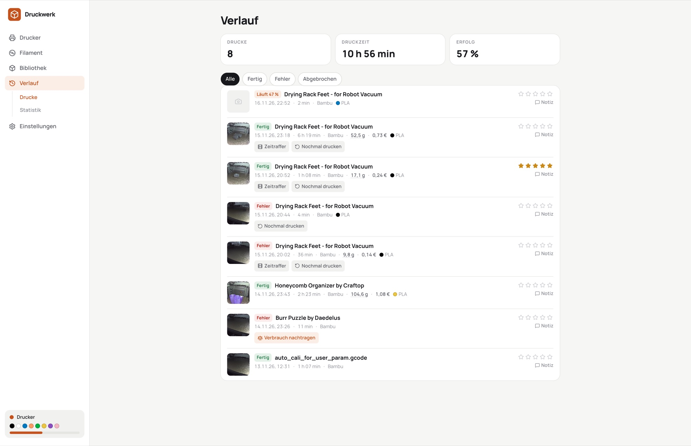 | 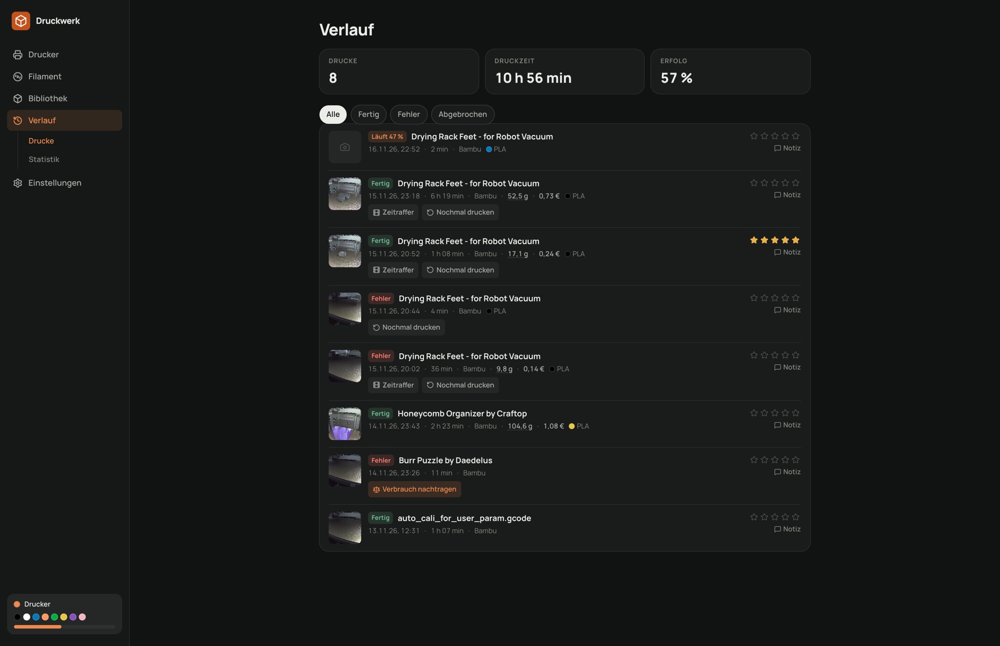 |

### Statistik
- Je Monat: Drucke, Ergebnis, Druckzeit, Filament nach Material, Filament- und Stromkosten, als Diagramm und Tabelle
- Zeitraum von drei Monaten bis alles

### Archiv und Zeitraffer
- Drucke aus Bambu Studio oder vom Drucker: Die App holt die `.gcode.3mf` von der SD-Karte und legt sie als Modell ab
  (Tag „Archiv“), dieselbe Datei nur einmal
- **„Nochmal drucken“** im Verlauf öffnet den Druckdialog mit derselben Platte
- **Zeitraffer** holt die App nach jedem Druck vom Drucker und spielt sie direkt im Verlauf ab (AVI wird per ffmpeg zu MP4)

### Wartung
- Wartungspunkte je Drucker, fällig nach Druckstunden (aus dem Verlauf plus Stunden vor Druckwerk) oder nach Tagen
- Fortschritt je Punkt, „Erledigt“ setzt ihn zurück. Vorschläge mit üblichen Intervallen zum Start
- Fällige Punkte stehen im Drucker-Dashboard und kommen auf Wunsch als Benachrichtigung

| Statistik | Wartung |
|---|---|
| 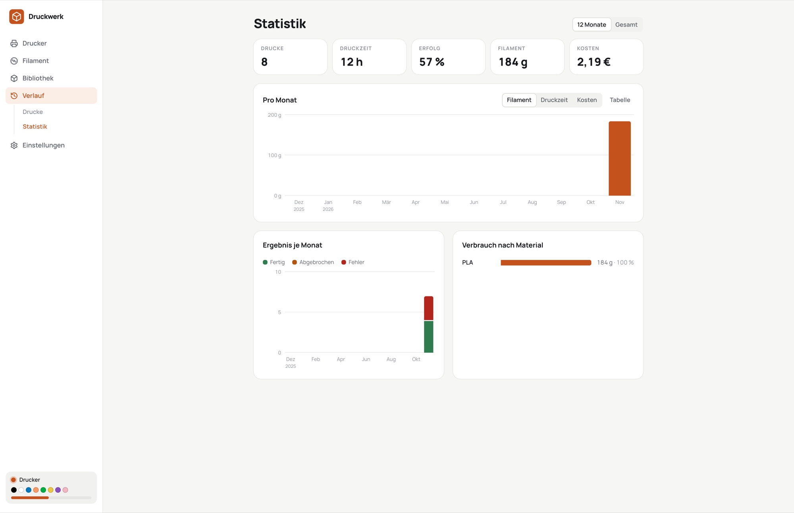 | 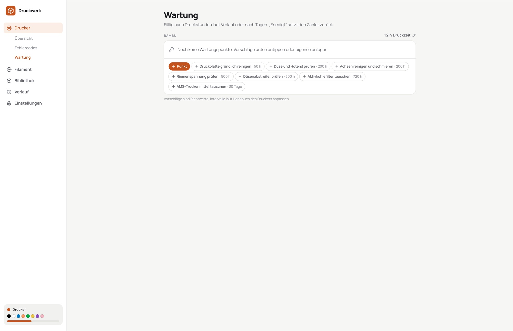 |

### Kosten, Bestand und Etiketten
- Kosten je Druck aus Spulenpreis und Strom: eine **Shelly- oder Tasmota-Steckdose** je Drucker misst die Energie, sonst
  Leistung × Zeit
- **Reicht die Spule?** Der Druckdialog vergleicht die Gramm der Platte mit dem Rest der zugeordneten Spule
- **Mindestbestand** je Marke, Sorte, Material oder Farbe (eine Grundfarbe zählt ihre ganze Familie), dazu eine **Einkaufsliste**:
  jeder Shop, in dem du eine passende Spule gekauft hast, mit letztem Preis, der günstigste je kg markiert
- **QR-Etiketten** für Spulen (50 × 30, 62 × 29 mm oder A4-Bogen): Mit der iPhone-Kamera scannen öffnet die Spule in der App

### Benachrichtigungen
- ntfy (Foto als Anhang), Gotify (Markdown mit Foto) und Webhook (JSON, z. B. für Home Assistant), alles optional
- Druck fertig oder fehlgeschlagen, Druckerfehler (HMS), Spule fast leer, AMS-Feuchte über Grenze, automatische Trocknung,
  nächster Druck der Warteschlange, Wartung fällig
- Ein Test-Knopf in den Einstellungen schickt je Kanal eine Meldung

### Fehlercodes
- Rund 1.900 HMS-Meldungen und 480 Druckfehler aller Bambu-Drucker, auf Deutsch
- Durchsuchbar, nach Bereich gefiltert, je Code mit Link ins Bambu-Wiki
- Viele Codes führt Bambu ohne Text und ohne Wiki-Seite; dann nennt die Meldung das betroffene Teil (AMS-Einheit, Kamera, System …)
- Die Liste liegt der App bei, sie fragt Bambu nie

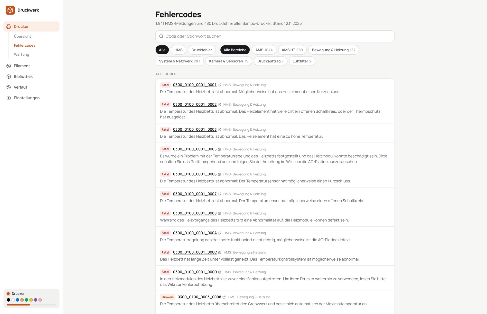

### Rund um die App
- **Erste Schritte**: Assistent beim ersten Start für Drucker, Filament und Link-Import, jeder Schritt lässt sich überspringen
- **Einstellungen** nach Themen gruppiert mit Suche über alle Felder, je Feld mit Erklärung, Standardwert und Fundort
- Fürs Handy gebaut: Leiste unten, Tabs statt Seitenleiste, Spulen per langem Druck ins Fach ziehen
- **Dunkelmodus** folgt dem System

| Erste Schritte | Einstellungen |
|---|---|
| 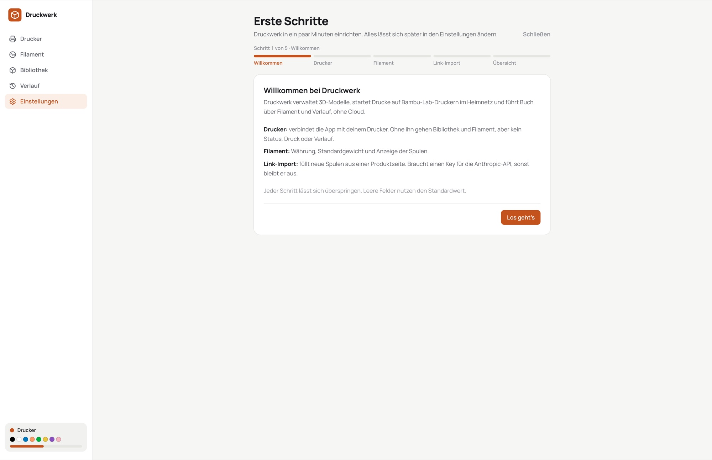 | 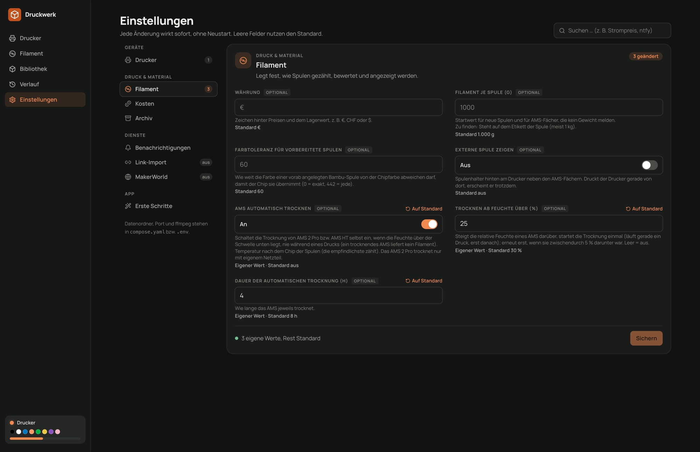 |

<p align="center">
  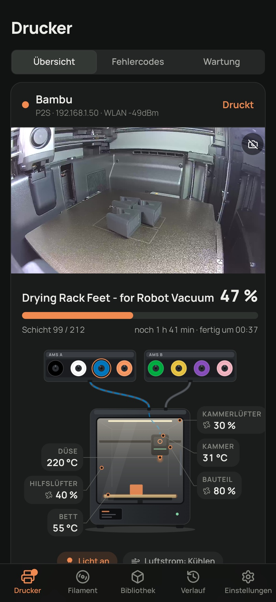
  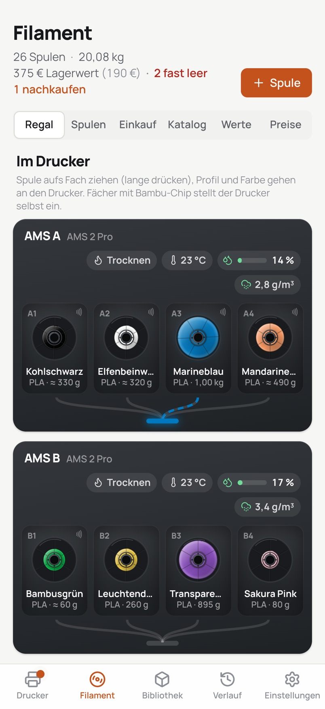
  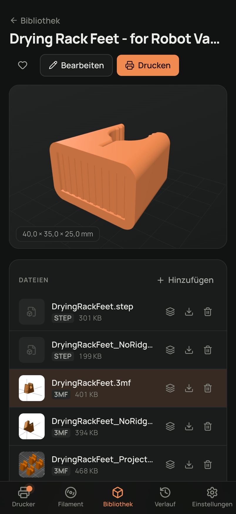
  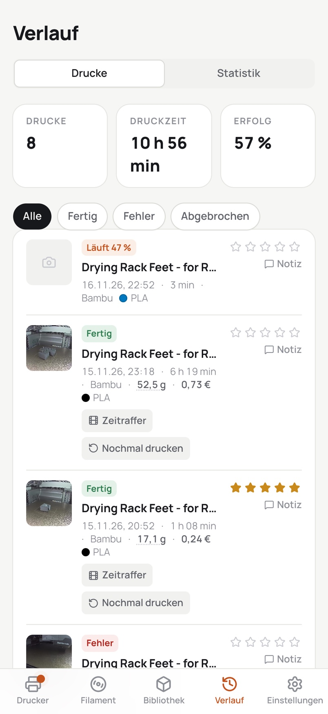
</p>

## 🔌 Drucker und Integrationen

| Was | Was es bringt | Wie |
|---|---|---|
| **Bambu Lab A1, A1 mini, P1P, P1S** | Status, Befehle, Druckstart, Kamera über TLS | LAN-Modus am Drucker, Adresse, Seriennummer, Zugangscode |
| **Bambu Lab P2S, X1 Carbon, X1E, H2D, H2S** | Status, Befehle, Druckstart, Kamera über RTSPS | Wie oben, dazu LAN-Liveview am Drucker und ffmpeg im Image |
| **AMS, AMS 2 Pro, AMS HT** | Fächer, Chip-Spulen, Feuchte, Temperatur, Trocknung | Automatisch mit dem Drucker |
| **Bambu Studio** | Dort gestartete Drucke landen im Verlauf und buchen ihr Filament ab | Automatisch, die App holt die Datei vom Drucker |
| **Shelly, Tasmota** | Energie je Druck für die Stromkosten | Adresse der Steckdose je Drucker in den Einstellungen |
| **ntfy, Gotify, Webhook** | Benachrichtigungen aufs Handy oder in Home Assistant | Adressen und Tokens in den Einstellungen |
| **Printables** | Suchen, in der App drucken, in OrcaSlicer öffnen, Modell samt Dateien und Bildern übernehmen | Nichts, nutzt die öffentliche API |
| **MakerWorld** | Suchen, Druckprofile, in der App drucken, Modell mit Bildern und der 3MF eines Profils übernehmen | Suchen: nichts. Dateien: Anmeldung mit dem Bambu-Konto in den Einstellungen |
| **Bambu Studio (Linux)** | Slicen in der App mit den offiziellen Drucker-, Prozess- und Filamentprofilen von Bambu Lab (auf ARM OrcaSlicer) | Build-Argument `SLICER=1` oder `SLICER_BIN` |
| **Anthropic-API** | Link-Import: Spule aus einer Shopseite füllen, Angaben eines Modells von anderen Seiten | API-Key in den Einstellungen, Modell wählbar |

Der Druckstart aus der App braucht am Drucker den **Entwicklermodus** (Firmware mit Authorization Control nimmt Befehle
fremder Apps nur im LAN-Modus mit Entwicklermodus an) und eine SD-Karte bzw. einen USB-Stick. Ohne Entwicklermodus gehen
Status, Kamera, Licht und Verlauf.

## 🔬 Unter der Haube

Was im Hintergrund passiert, damit es vorne einfach wirkt.

### Druckeranbindung
- **MQTT über TLS** (8883) für Status und Befehle. Berichte sind Deltas: tief gemergt, Arrays ersetzt, Antworten auf
  Befehle getrennt von Statusberichten
- **FTPS** (implizit, 990) für den Upload und zum Nachlesen von Dateien woanders gestarteter Drucke
- **Kamera**: A1 und P1 schicken JPEG-Frames über TLS auf 6000, X1, H2 und P2S streamen RTSPS auf 322 über ffmpeg. Ausgabe
  als MJPEG, eine Verbindung je Drucker, 5 s nach dem letzten Zuschauer zu
- Der Verlauf entsteht aus den Wechseln des Druckzustands; abgebrochene und fehlgeschlagene Drucke trennt der Fehlercode

### Filament-Buchhaltung
- Nach jedem Bericht mit geänderten Fächern gleicht die App das AMS ab: Ein neuer Chip übernimmt zuerst eine vorbereitete
  Spule (gleiches Profil, ähnliche Farbe, älteste zuerst), sonst entsteht eine neue Bambu-Spule
- **Verbrauch je Druck** aus `slice_info.config` der Platte: Gramm je Filament × Fortschritt, einmal je Druck auf die Spule
  gebucht, die beim Start im Fach lag. Ohne Slice-Info der Rückgang des Chip-Füllstands × Spulengewicht
- Ist eine Spule einmal gewogen oder von Hand korrigiert, zählen ab dann nur noch Druckbuchungen

### Modelle und Dateien
- Uploads gehen als Stream auf die Platte, sha256 nebenbei, ZIPs werden entpackt
- **3MF-Auswertung**: Platten, Filamente, Druckzeit und Drucker aus der Slice-Info, Plattenbilder direkt aus der Datei
- **Vorschaubilder** für STL, OBJ und 3MF rendert der Browser mit three.js (Z-up nach Y-up gedreht, aufs Bett gesetzt) und
  lädt sie zum Server hoch

### Daten
- **SQLite über `node:sqlite`**, keine native Abhängigkeit. Migrationen über `user_version`
- **Einstellungen** mit klarer Reihenfolge: Wert in der App, sonst Umgebung, sonst eingebauter Standard. Bei jedem Zugriff
  gelesen, Änderungen wirken sofort
- Zugangscode des Druckers und API-Key verlassen den Server nie; die Oberfläche zeigt nur einen Hinweis wie `…abcd`

## 🚀 Schnellstart

### Docker

```bash
git clone https://github.com/Yatheria030/druckwerk.git
cd druckwerk
mkdir -p data
docker compose up -d --build
```

Dann http://localhost:8795 öffnen. `compose.yaml` legt Datenbank, Modelldateien, Vorschaubilder und Fotos in `./data` ab
und baut das Image mit ffmpeg für die Kamera von X1, H2 und P2S und mit Bambu Studio zum Slicen in der App
(`SLICER: "1"`; Bambu Studio auf amd64, OrcaSlicer auf arm64, wo es Bambu Studio nicht für Linux gibt; `"0"`, wenn du nur am Rechner slicst).

### Node

Braucht Node 24.

```bash
npm ci
npm run build
npm start
```

Beim ersten Start öffnet sich **Erste Schritte**. Nichts ist Pflicht: Bibliothek und Filament gehen auch ohne Drucker.
Vor dem Verbinden am Drucker den **LAN-Modus** einschalten, für den Druckstart aus der App zusätzlich den **Entwicklermodus**.

## ⚙️ Konfiguration

Alle Werte stehen in den Einstellungen der App und liegen in der Datenbank. Leeres Feld heißt Standard. Umgebungsvariablen
gelten nur, solange in der App nichts gesetzt ist.

| Wert | Pflicht? | Standard | Umgebung | In der App |
|---|---|---|---|---|
| Drucker: Name | für den Drucker | – | `BAMBU_NAME` (Standard „Drucker“) | Einstellungen → Drucker, Assistent Schritt 2 |
| Drucker: Modell | für den Drucker | P2S | `BAMBU_MODEL` | Einstellungen → Drucker, Assistent Schritt 2 |
| Drucker: IP-Adresse | für den Drucker | – | `BAMBU_HOST` | Am Drucker: Einstellungen → WLAN bzw. Netzwerk |
| Drucker: Seriennummer | für den Drucker | – | `BAMBU_SERIAL` | Am Drucker: Einstellungen → Gerät, oder Bambu Studio |
| Drucker: Zugangscode | für den Drucker | – | `BAMBU_ACCESS_CODE` | Am Drucker beim LAN-Modus |
| Währung | optional | € | – | Einstellungen → Filament |
| Filament je Spule | optional | 1000 g | – | Einstellungen → Filament |
| Farbtoleranz für vorbereitete Spulen | optional | 60 (0–442) | – | Einstellungen → Filament |
| Externe Spule zeigen | optional | aus | – | Einstellungen → Filament |
| AMS automatisch trocknen | optional | aus | – | Einstellungen → Filament |
| Auto-Trocknen ab Feuchte, Dauer | optional | 30 %, 8 h | – | Einstellungen → Filament |
| Strompreis | optional | – (keine Stromkosten) | – | Einstellungen → Kosten |
| Leistung ohne Steckdose | optional | – | – | Einstellungen → Kosten |
| Drucke aus Bambu Studio archivieren | optional | an | – | Einstellungen → Archiv |
| Zeitraffer holen | optional | an | – | Einstellungen → Archiv |
| ntfy-Thema und -Token | optional | – | – | Einstellungen → Benachrichtigungen |
| Gotify-Server und App-Token | optional | – | – | Einstellungen → Benachrichtigungen |
| Webhook | optional | – | – | Einstellungen → Benachrichtigungen |
| Adresse von Druckwerk (Links und Fotos in Meldungen) | optional | – | – | Einstellungen → Benachrichtigungen |
| Melden bei Druck fertig, fehlgeschlagen, HMS, Auto-Trocknen, Warteschlange, Wartung | optional | an | – | Einstellungen → Benachrichtigungen |
| Spule fast leer unter | optional | 100 g (0 = aus) | – | Einstellungen → Benachrichtigungen |
| AMS-Feuchte über | optional | – (aus) | – | Einstellungen → Benachrichtigungen |
| API-Key für den Link-Import | optional | – (Import aus) | `ANTHROPIC_API_KEY` | Einstellungen → Link-Import (Anthropic-API) |
| Modell für den Link-Import | optional | `claude-opus-5-5` | `SCRAPE_MODEL` | Einstellungen → Link-Import (Anthropic-API) |
| Bambu-Konto für MakerWorld-Dateien | optional | – | – | Einstellungen → MakerWorld (gespeichert nur das Token) |

Der Drucker ist nur für Status, Druckstart, Kamera und Verlauf nötig. Die `BAMBU_*`-Variablen legen den Drucker beim Start
einmalig an, wenn es seine Seriennummer noch nicht gibt. Vorlage für alle Variablen: [`.env.example`](.env.example).

Nur als Umgebung, weil sie vor der Datenbank feststehen müssen:

| Variable | Standard | Wofür |
|---|---|---|
| `DATA_DIR` | `data` (im Image `/data`) | Datenbank, Modelldateien, Vorschaubilder, Druckfotos |
| `PORT` | `8795` | Port für API und Oberfläche |
| `HOST` | `127.0.0.1` (im Image `0.0.0.0`) | Adresse, an die der Server bindet |
| `FFMPEG` (Build-Argument) | `0` | `1` installiert ffmpeg für die Kamera von X1, H2 und P2S |
| `SLICER` (Build-Argument) | `0` | `1` installiert die Kommandozeile von Bambu Studio (auf arm64 OrcaSlicer) mit den Bambu-Lab-Profilen zum Slicen in der App. Eine AppImage in `vendor/` wird statt eines Downloads genommen |
| `SLICER_BIN` | automatisch gefunden | Pfad zu Bambu Studio bzw. OrcaSlicer, wenn woanders installiert (Bambu Studio hat Vorrang) |

### Netzwerk

Die App spricht den Drucker direkt an: MQTT TLS (8883), FTPS (990 plus passive Ports), Kamera auf 6000 (A1, P1) bzw.
RTSPS 322 (X1, H2, P2S). Liegt der Drucker in einem anderen Netz, müssen diese Ports vom Container aus erreichbar sein.
Zeiten zeigt die Oberfläche in der Zeitzone des Browsers. Viele Drucker im LAN-Modus führen ihre Uhr in der falschen Zone
(eine P2S ohne Kopplung mit der Handy-App läuft auf UTC+8); Druckwerk lernt den Abstand aus Zeitraffern und neuen Meldungen
und kennzeichnet umgerechnete Zeiten.

## 💾 Sicherung

Alles liegt im Datenordner (`DATA_DIR`, mit Docker `./data`): `stl.db`, `files/`, `thumbs/` und `photos/`. Zum Sichern den
Container stoppen und den Ordner kopieren; zum Wiederherstellen zurücklegen und neu starten.

## 🛠 Entwickeln

```bash
npm run dev:server
```

```bash
npm run dev:web
```

Vite läuft auf :5181 und leitet `/api` an den Server auf :8795 weiter. Prüfen mit `npm run typecheck`, bauen mit
`npm run build` (nach `dist/`, der Server liefert es aus).

```
server/   Hono-API, SQLite-Schema, Upload und 3MF-Auswertung, Druckeranbindung, Kamera, Slicer, Filament, Katalog,
          Link-Import; specs/ enthält die Datenblattwerte je Marke
shared/   Typen und Logik für Server und UI (Einstellungen, Druckprofile, Farbnamen, Katalog)
web/      React-UI: Seiten in pages/, Bausteine in ui/, three.js-Laden und Vorschaubilder in lib/three.ts
scripts/  Fehlercodes und Farbkataloge aktualisieren (Sunlu, eSUN, SpoolmanDB)
docs/     Screenshots
```

**Stack**: Hono auf Node 24 (läuft per tsx direkt aus TypeScript), `node:sqlite`, React 19, Vite, Tailwind CSS 4,
TanStack Query, three.js.

Die Screenshots zeigen einen simulierten Drucker mit Beispieladresse und Beispiel-Seriennummer.

## 🔒 Datenschutz

Ein Container, eine SQLite-Datei, ein Datenordner. Keine Bambu-Cloud für den Drucker, kein Tracking, keine Telemetrie. Die App
spricht den Drucker direkt in deinem Netz an. Nach außen geht nur, was du selbst nutzt: die Tabs Printables und MakerWorld,
die MakerWorld-Anmeldung (nur für deren Dateien) und der Link-Import, sobald du einen API-Key einträgst.

Druckwerk ist ein privates Projekt und steht in keiner Verbindung zu Bambu Lab. Bambu Lab, AMS und Bambu Studio sind Marken
ihrer Inhaber. Die Felder des Drucker-Protokolls sind nicht offiziell dokumentiert und können sich mit neuer Firmware ändern.

## 📄 Lizenz

[MIT](LICENSE)
