<div align="center">

# 🖨️ Druckwerk

[English](README.md) · **Deutsch**

**Eine Filament-Bibliothek, die sich selbst pflegt, dazu deine 3D-Modelle, Drucker und Druckverlauf, direkt im Heimnetz.**

Selbst gehostet · ein Container · SQLite · keine Cloud, kein Konto

[](LICENSE)
[](https://nodejs.org)
[](https://react.dev)
[](https://threejs.org)
[](https://nodejs.org/api/sqlite.html)
[](compose.yaml)
[](#)

[Schnellstart](#-schnellstart) · [Funktionen](#-funktionen) · [Drucker](#-drucker-und-integrationen) ·
[Konfiguration](#%EF%B8%8F-konfiguration)

<picture><source media="(prefers-color-scheme: dark)" srcset="docs/images/regal-animation-dunkel.gif">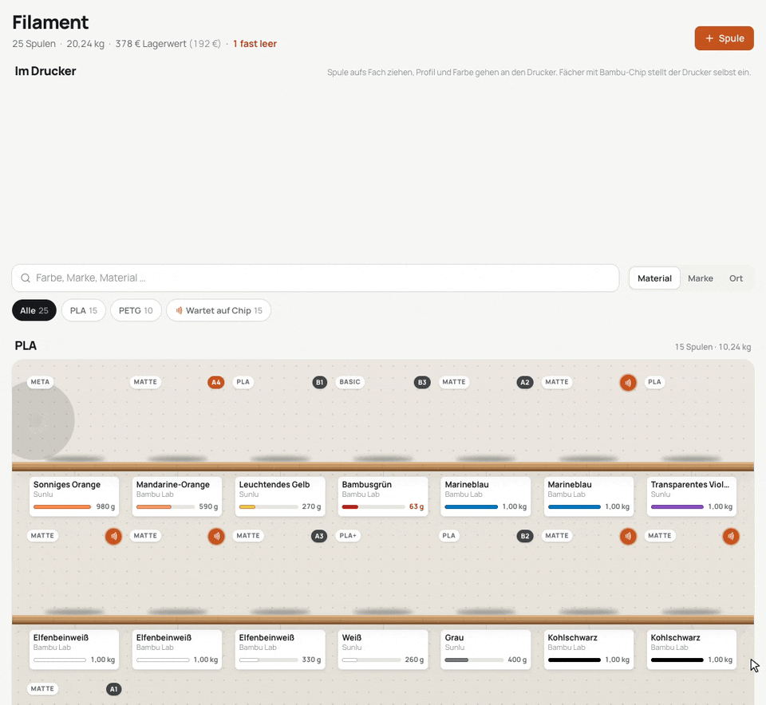</picture>

<picture><source media="(prefers-color-scheme: dark)" srcset="docs/images/dashboard-dunkel.jpg">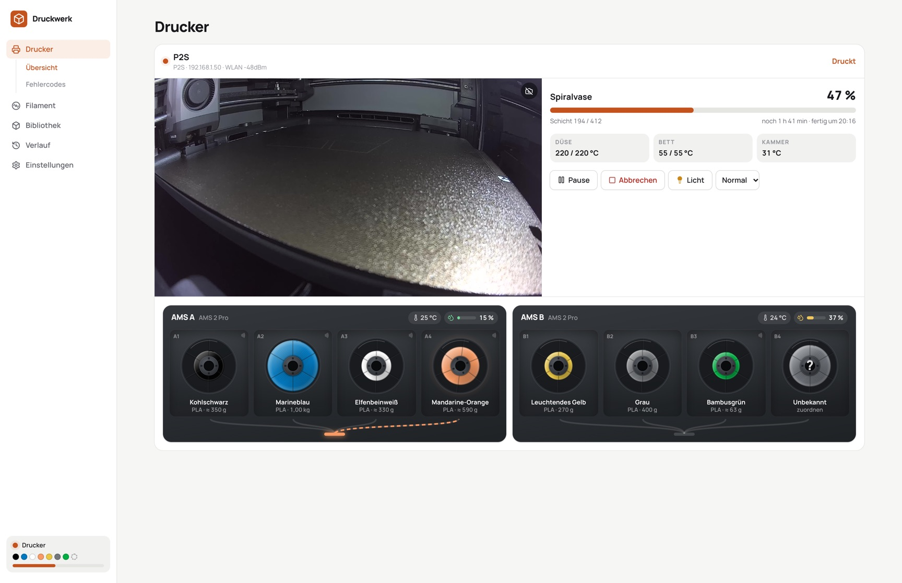</picture>

</div>

Jede Spule, die du hast, steht im Regal, das AMS direkt darüber. Bambu-Spulen melden sich per Chip selbst an, jeder Druck
bucht seine Gramm von der Spule ab, die wirklich im Fach lag, und Einlegen heißt: Spule aufs Fach ziehen. Du weißt immer,
was noch da ist, was es gekostet hat und was nachbestellt werden muss, ohne Tabelle und ohne Cloud.

Drumherum ist Druckwerk der Rest deines Drucker-Setups: eine Bibliothek für deine Modelle mit 3D-Vorschau, Druckstart direkt
auf dem Drucker, Live-Status mit Kamera und ein Verlauf mit Foto jeder Platte. Zum Slicen bleibt Bambu Studio. Alles bleibt
in deinem Netz.

## Inhalt

- [Highlights](#-highlights)
- [Funktionen](#-funktionen)
- [Drucker und Integrationen](#-drucker-und-integrationen)
- [Unter der Haube](#-unter-der-haube)
- [Schnellstart](#-schnellstart)
- [Konfiguration](#%EF%B8%8F-konfiguration)
- [Sicherung](#-sicherung)
- [Entwickeln](#-entwickeln)
- [Datenschutz](#-datenschutz)
- [Lizenz](#-lizenz)

## ✨ Highlights

- 🧵 **Ein Filamentregal, das sich selbst pflegt**: jede Spule auf Holzbrettern, mit Füllstand, Preis und Lagerwert
- 🏷️ **Bambu-Spulen melden sich selbst an**: Chip im AMS gelesen, Spule mit offiziellem Farbnamen angelegt. Spulen aus einer
  Bestellung warten im Vakuumbeutel, bis ihr Chip auftaucht
- ⚖️ **Jedes Gramm gebucht**: Verbrauch je Druck aus dem Slice, von der Spule, die im Fach lag, auch bei Drucken aus Bambu Studio
- 🖱️ **Spule aufs AMS-Fach ziehen**: Profil, Farbe und Düsentemperaturen gehen an den Drucker
- 🎨 **Farbkatalog** mit allen Farben von Bambu Lab und Sunlu, dazu Link-Import aus jeder Shopseite
- 📡 **Der Drucker, live**: Status, Temperaturen, Kamera, Pause, Abbruch, Licht und Geschwindigkeit, direkt über das LAN
- 📚 **Eine Bibliothek für alle Modelle**: STL, 3MF, OBJ, STEP und geslicte `.gcode.3mf` mit 3D-Vorschau
- ▶️ **Drucken mit einem Klick**: Platte wählen, Filamente den AMS-Fächern zuordnen, los
- 📸 **Ein Verlauf, der sich selbst schreibt**: jeder Druck mit Foto der Platte, Verbrauch, Sternen und Notiz
- 🛟 **Alle Fehlercodes auf Deutsch**: rund 1.900 HMS-Meldungen und 480 Druckfehler, offline
- 🌗 **Hell und dunkel**, vom iPhone bis zum 16"-MacBook
- 🔒 **Alles bleibt bei dir**: ein Container, eine SQLite-Datei, ein Datenordner

## 🧩 Funktionen

### Filamentregal
Das Herz der App. Spulen rollen ins Regal, heben und drehen sich beim Drüberfahren, und die Spule, aus der gerade gedruckt
wird, dreht sich im AMS-Fach, während der Faden zum Drucker läuft.

- Alle Spulen auf Holzbrettern, gruppiert nach Material, Marke oder Ort, mit Füllstand, Preis und Lagerwert
- Oben sitzen die AMS-Fächer: **Spule aufs Fach ziehen** legt sie ein, Profil, Farbe und Düsentemperaturen gehen an den
  Drucker. Ablegen auf ein belegtes Fach tauscht. Am Touchscreen startet ein langer Druck das Ziehen
- **Bambu-Spulen mit Chip** legt die App beim Einlegen selbst an, mit offiziellem deutschem Farbnamen. Vorab angelegte Spulen
  aus einer Bestellung warten im Vakuumbeutel („Wartet auf Chip“) und übernehmen den Chip, sobald er zum ersten Mal gelesen wird
- **Füllstand**: Chip-Spulen folgen dem AMS, jeder Druck bucht sein Filament aus den Gramm je Filament im Slice ab,
  abgebrochene Drucke nach Fortschritt. Das klappt auch für Drucke, die in Bambu Studio gestartet wurden
- **Fremdspulen** bekommen einen Startwert (Gramm oder voll, ¾, ½, ¼) und lassen sich mit der Küchenwaage nachwiegen
- **Druckprofile** wählt die App passend zu Material und Sorte (Matte, Silk, CF …), auch für Fremdfilament

| Hell | Dunkel |
|---|---|
| 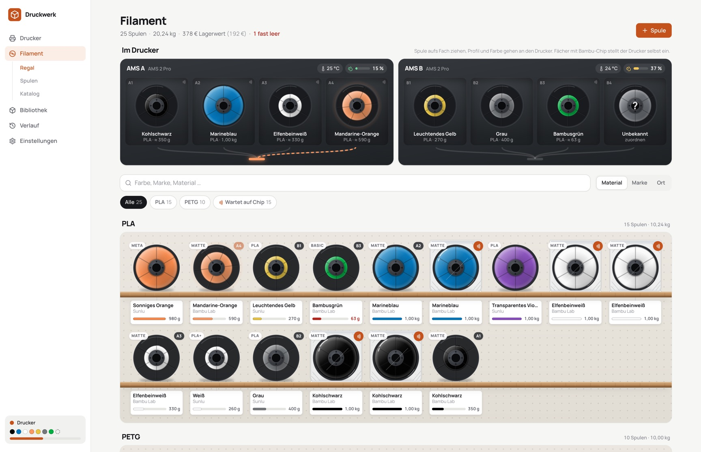 | 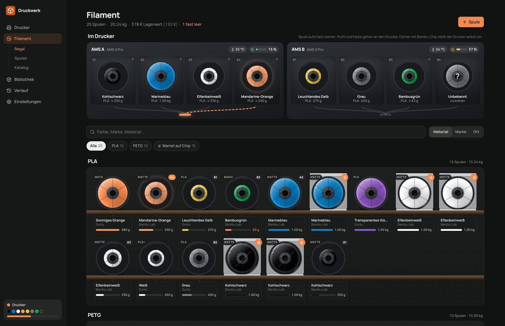 |

### Spulen
- Marke, Sorte, Farbe aus dem Katalog, Gewichte, Preise mit Rabatt, Druckprofil mit Temperaturen und Trocknung
- **Link-Import**: Produktlink einfügen, die Anthropic-API liest die Shopseite und füllt alles aus (optional, eigener API-Key)
- Die Liste „Spulen“ zeigt alle Spulen als Tabelle: Hex, Profil, Düse, Ort, Chip-Status, Preis je Kilo, zuletzt genutzt
  und Rest, sortierbar, auf schmalen Bildschirmen mit weniger Spalten

| Spulendialog | Spulenliste |
|---|---|
| 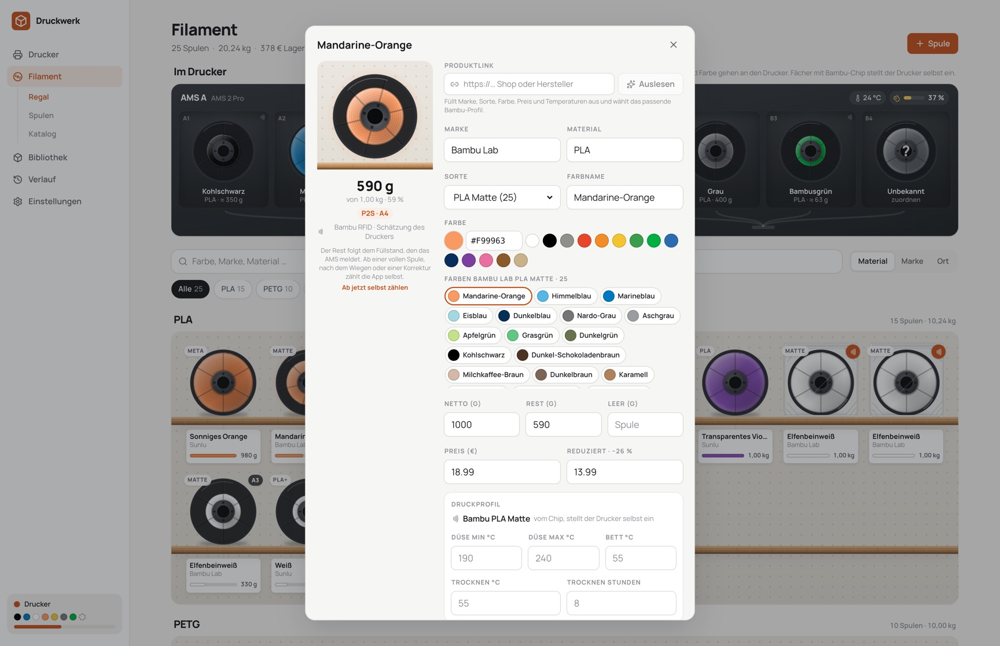 | 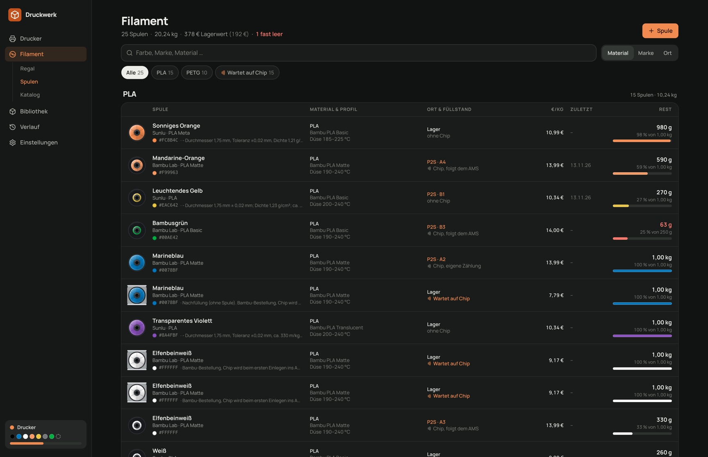 |

### Farbkatalog
- Alle Sorten und Farben von **Bambu Lab** (aus Bambu Studio, mit deutschen Namen und Chip-Codes) und **Sunlu**
- Suche über alle Farben, Hex und Herstellercode
- Eigene Marken, Sorten und Farben anlegen und ändern. Unbekannte Hex-Werte bleiben unbekannt, statt geraten zu werden

| Hell | Dunkel |
|---|---|
| 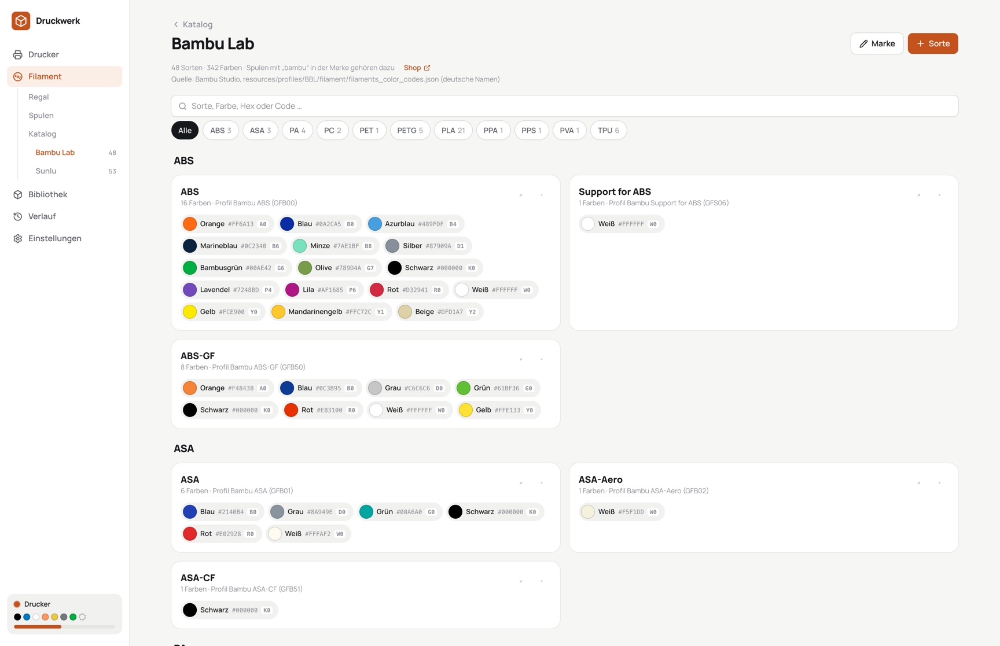 | 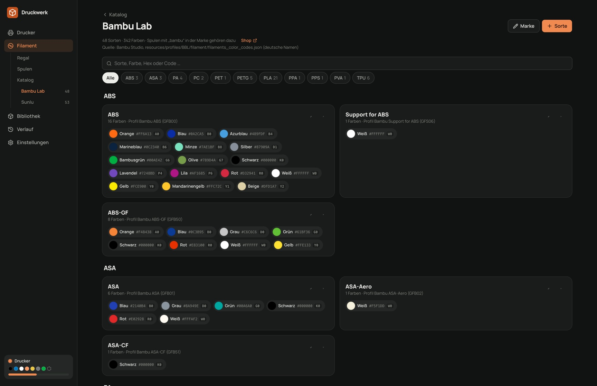 |

### Drucker-Dashboard
- Status, Fortschritt, Schicht, Restzeit und Uhrzeit des Druckendes, Düse, Bett und Kammer
- **Live-Kamera** (A1, P1 über TLS, X1, H2 und P2S über RTSPS)
- **Pausieren, fortsetzen, abbrechen**, Licht schalten, Geschwindigkeit wählen (leise, normal, Sport, rasend)
- Meldet der Drucker ein Problem (HMS), steht es auf Deutsch da, mit Link ins Bambu-Wiki
- **AMS-Einheiten, wie sie im Drucker stehen**: Feuchte und Temperatur je Einheit, laufende Trocknung, jedes Fach mit Farbe,
  Name und Rest. Aus dem aktiven Fach dreht sich die Spule und der Faden läuft zum Drucker

### Modell-Bibliothek
- Modelle mit beliebig vielen Dateien: STL, 3MF, OBJ, STEP, geslicte `.gcode.3mf`, Bilder und mehr
- **Dateien auf die Seite ziehen**, jede ZIP wird ein eigenes Modell
- Vorschaubilder rendert der Browser selbst, geslicte Dateien bringen ihre Plattenbilder mit
- Tags, Favoriten, Suche und Filter „druckbereit“
- Modellseite mit **drehbarer 3D-Vorschau** und Maßen, allen Dateien, Beschreibung, Quelle, Lizenz und jedem Druck des Modells
- Geslicte Dateien nennen Druckzeit, Gewicht und Filamente je Platte. „In Bambu Studio öffnen“ übergibt eine Datei zum Slicen

| Bibliothek | Modell |
|---|---|
| 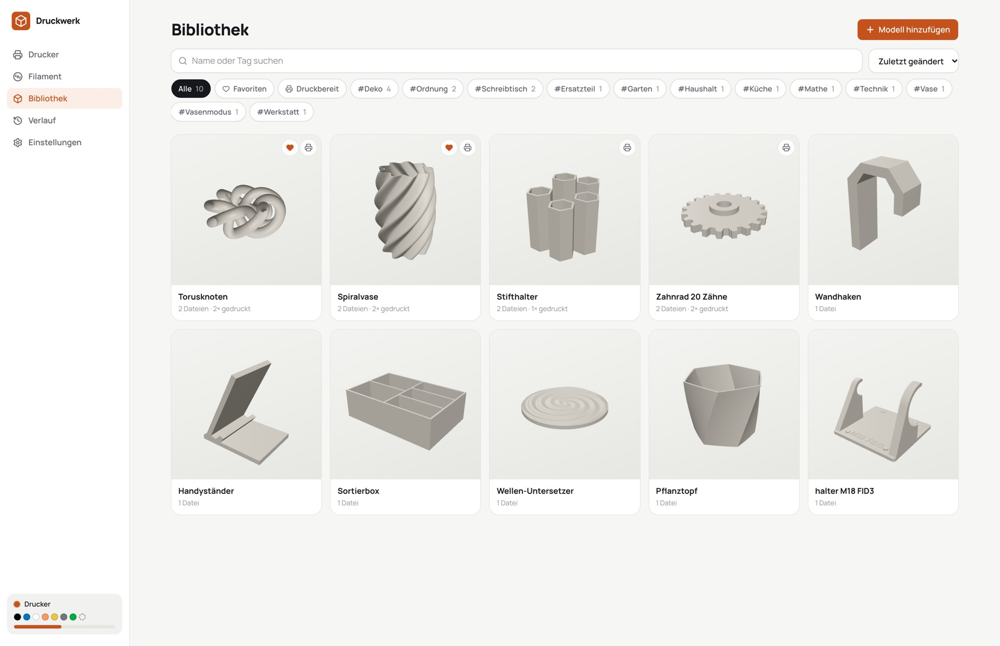 | 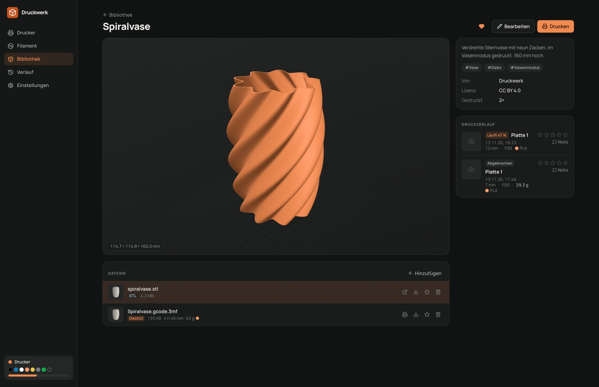 |

### Drucken
- Geslicte `.gcode.3mf` startet die App direkt
- Platte wählen, **Filamente den AMS-Fächern zuordnen** (vorbelegt nach Material und Farbe), Bett nivellieren, Flussrate
  kalibrieren, Zeitraffer
- Die Datei geht per FTPS auf die SD-Karte des Druckers

| Hell | Dunkel |
|---|---|
| 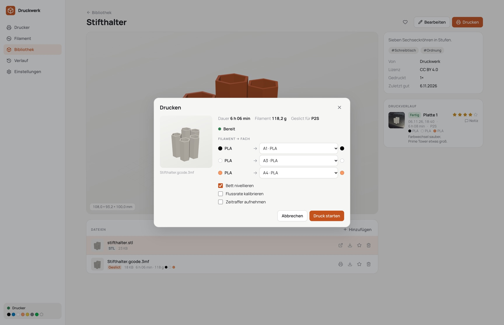 | 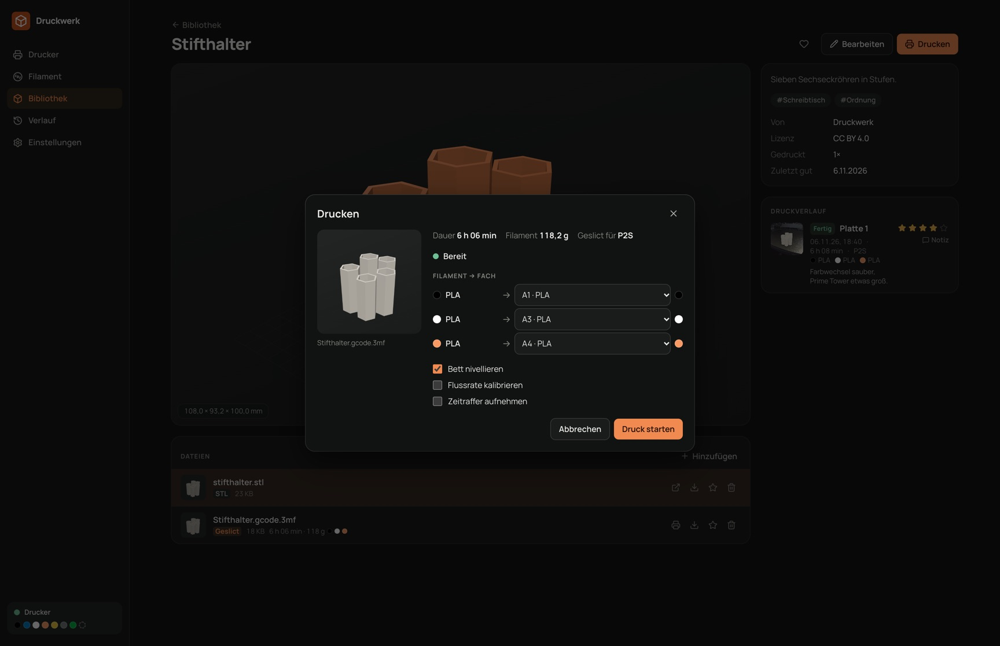 |

### Verlauf
- Jeder Druck kommt automatisch in den Verlauf, auch aus Bambu Studio oder vom Drucker selbst, und wird dem Modell zugeordnet
- Am Ende jedes Drucks ein **Foto der Platte**
- Sterne und Notiz je Druck, Fehler mit Code und Klartext
- Oben Anzahl, Druckzeit und Erfolgsquote

| Hell | Dunkel |
|---|---|
| 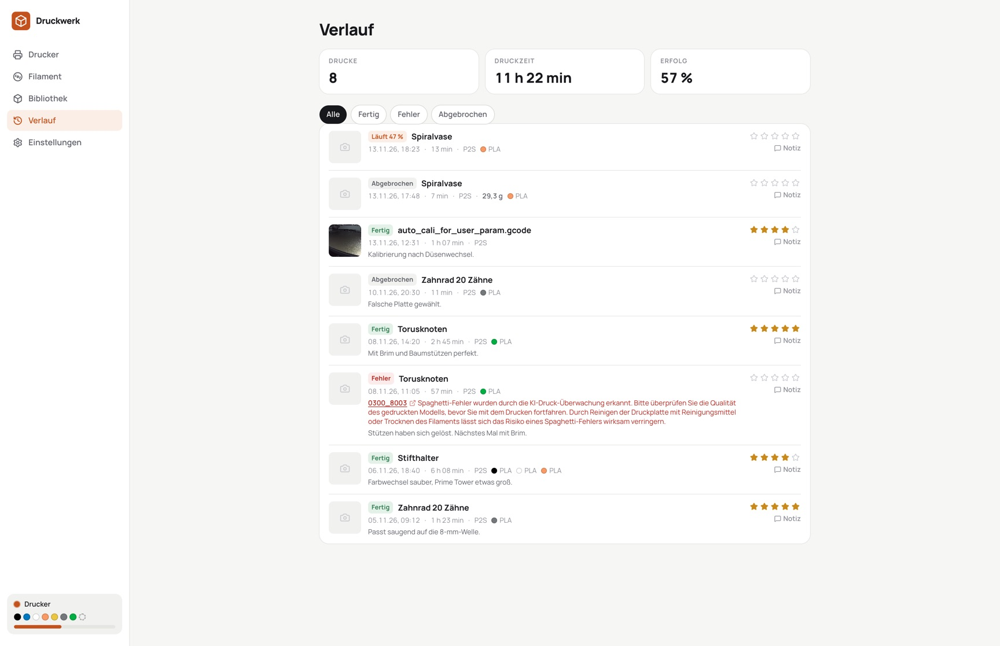 | 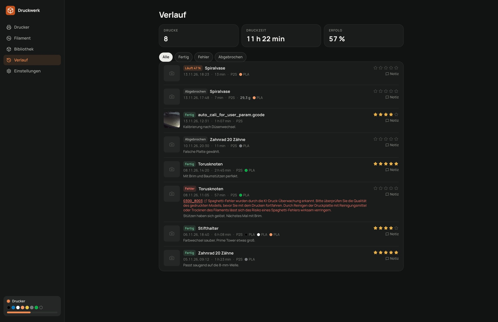 |

### Fehlercodes
- Rund 1.900 HMS-Meldungen und 480 Druckfehler aller Bambu-Drucker, auf Deutsch
- Durchsuchbar, nach Bereich gefiltert, je Code mit Link ins Bambu-Wiki
- Die Liste liegt der App bei, sie fragt Bambu nie

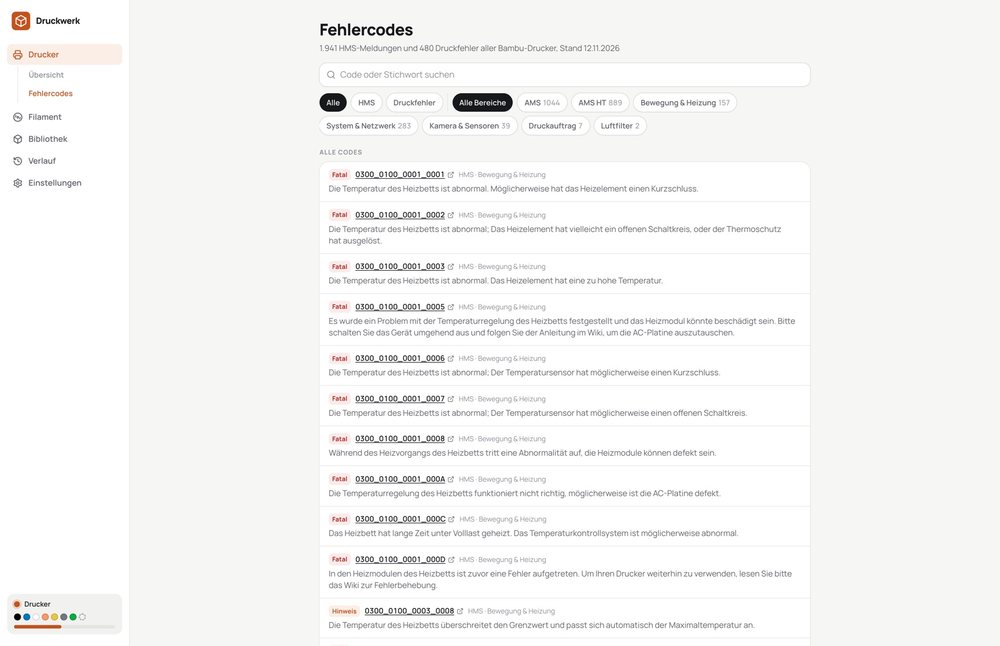

### Rund um die App
- **Erste Schritte**: Assistent beim ersten Start für Drucker, Filament und Link-Import, jeder Schritt lässt sich überspringen
- **Einstellungen** mit Erklärung, Standardwert und Fundort je Feld
- Fürs Handy gebaut: Leiste unten, Tabs statt Seitenleiste, Spulen per langem Druck ins Fach ziehen
- **Dunkelmodus** folgt dem System

| Erste Schritte | Einstellungen |
|---|---|
| 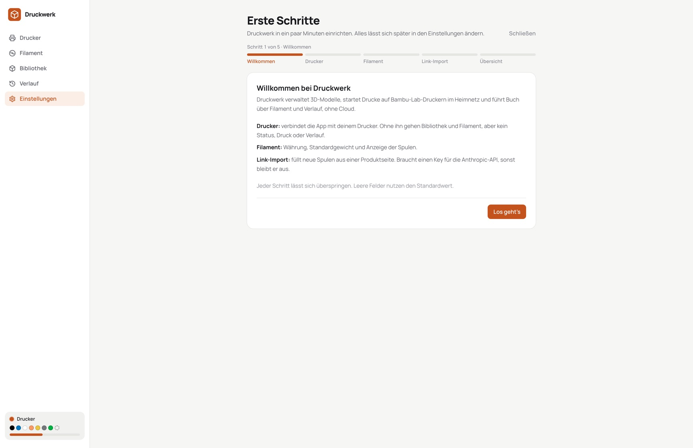 | 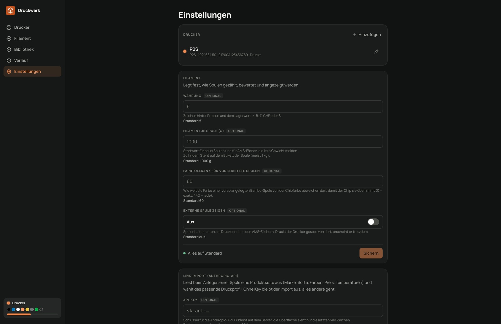 |

<p align="center">
  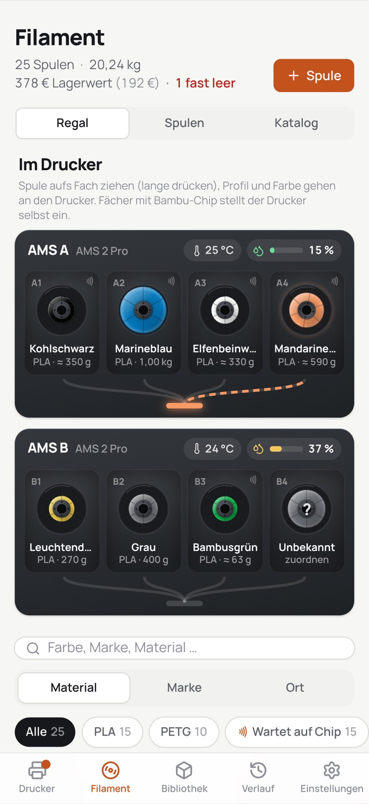
  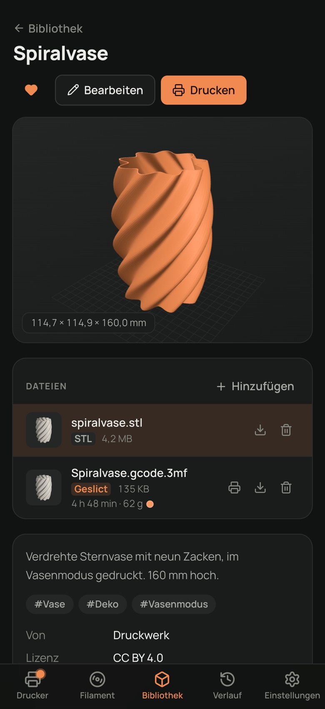
  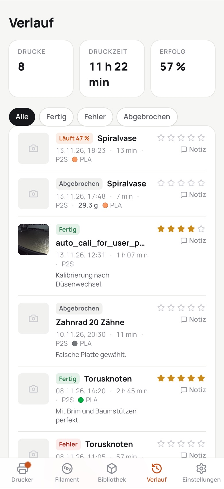
</p>

## 🔌 Drucker und Integrationen

| Was | Was es bringt | Wie |
|---|---|---|
| **Bambu Lab A1, A1 mini, P1P, P1S** | Status, Befehle, Druckstart, Kamera über TLS | LAN-Modus am Drucker, Adresse, Seriennummer, Zugangscode |
| **Bambu Lab P2S, X1 Carbon, X1E, H2D, H2S** | Status, Befehle, Druckstart, Kamera über RTSPS | Wie oben, dazu LAN-Liveview am Drucker und ffmpeg im Image |
| **AMS, AMS 2 Pro, AMS HT** | Fächer, Chip-Spulen, Feuchte, Temperatur, Trocknung | Automatisch mit dem Drucker |
| **Bambu Studio** | Dort gestartete Drucke landen im Verlauf und buchen ihr Filament ab | Automatisch, die App holt die Datei vom Drucker |
| **Anthropic-API** | Link-Import: Spule aus einer Shopseite füllen | API-Key in den Einstellungen, Modell wählbar |

Der Druckstart aus der App braucht am Drucker den **Entwicklermodus** (Firmware mit Authorization Control nimmt Befehle
fremder Apps nur im LAN-Modus mit Entwicklermodus an) und eine SD-Karte. Ohne Entwicklermodus gehen Status, Kamera und Verlauf.

## 🔬 Unter der Haube

Was im Hintergrund passiert, damit es vorne einfach wirkt.

### Druckeranbindung
- **MQTT über TLS** (8883) für Status und Befehle. Berichte sind Deltas: tief gemergt, Arrays ersetzt, Antworten auf
  Befehle getrennt von Statusberichten
- **FTPS** (implizit, 990) für den Upload und zum Nachlesen von Dateien woanders gestarteter Drucke
- **Kamera**: A1 und P1 schicken JPEG-Frames über TLS auf 6000, X1, H2 und P2S streamen RTSPS auf 322 über ffmpeg. Ausgabe
  als MJPEG, eine Verbindung je Drucker, 5 s nach dem letzten Zuschauer zu
- Der Verlauf entsteht aus den Wechseln des Druckzustands; abgebrochene und fehlgeschlagene Drucke trennt der Fehlercode

### Filament-Buchhaltung
- Nach jedem Bericht mit geänderten Fächern gleicht die App das AMS ab: Ein neuer Chip übernimmt zuerst eine vorbereitete
  Spule (gleiches Profil, ähnliche Farbe, älteste zuerst), sonst entsteht eine neue Bambu-Spule
- **Verbrauch je Druck** aus `slice_info.config` der Platte: Gramm je Filament × Fortschritt, einmal je Druck auf die Spule
  gebucht, die beim Start im Fach lag. Ohne Slice-Info der Rückgang des Chip-Füllstands × Spulengewicht
- Ist eine Spule einmal gewogen oder von Hand korrigiert, zählen ab dann nur noch Druckbuchungen

### Modelle und Dateien
- Uploads gehen als Stream auf die Platte, sha256 nebenbei, ZIPs werden entpackt
- **3MF-Auswertung**: Platten, Filamente, Druckzeit und Drucker aus der Slice-Info, Plattenbilder direkt aus der Datei
- **Vorschaubilder** für STL, OBJ und 3MF rendert der Browser mit three.js (Z-up nach Y-up gedreht, aufs Bett gesetzt) und
  lädt sie zum Server hoch

### Daten
- **SQLite über `node:sqlite`**, keine native Abhängigkeit. Migrationen über `user_version`
- **Einstellungen** mit klarer Reihenfolge: Wert in der App, sonst Umgebung, sonst eingebauter Standard. Bei jedem Zugriff
  gelesen, Änderungen wirken sofort
- Zugangscode des Druckers und API-Key verlassen den Server nie; die Oberfläche zeigt nur einen Hinweis wie `…abcd`

## 🚀 Schnellstart

### Docker

```bash
git clone https://github.com/Yatheria030/druckwerk.git
cd druckwerk
mkdir -p data
docker compose up -d --build
```

Dann http://localhost:8795 öffnen. `compose.yaml` legt Datenbank, Modelldateien, Vorschaubilder und Fotos in `./data` ab
und baut das Image mit ffmpeg für die Kamera von X1, H2 und P2S.

### Node

Braucht Node 24.

```bash
npm ci
npm run build
npm start
```

Beim ersten Start öffnet sich **Erste Schritte**. Nichts ist Pflicht: Bibliothek und Filament gehen auch ohne Drucker.
Vor dem Verbinden am Drucker den **LAN-Modus** einschalten, für den Druckstart aus der App zusätzlich den **Entwicklermodus**.

## ⚙️ Konfiguration

Alle Werte stehen in den Einstellungen der App und liegen in der Datenbank. Leeres Feld heißt Standard. Umgebungsvariablen
gelten nur, solange in der App nichts gesetzt ist.

| Wert | Pflicht? | Standard | Umgebung | In der App |
|---|---|---|---|---|
| Drucker: Name | für den Drucker | – | `BAMBU_NAME` (Standard „Drucker“) | Einstellungen → Drucker, Assistent Schritt 2 |
| Drucker: Modell | für den Drucker | P2S | `BAMBU_MODEL` | Einstellungen → Drucker, Assistent Schritt 2 |
| Drucker: IP-Adresse | für den Drucker | – | `BAMBU_HOST` | Am Drucker: Einstellungen → WLAN bzw. Netzwerk |
| Drucker: Seriennummer | für den Drucker | – | `BAMBU_SERIAL` | Am Drucker: Einstellungen → Gerät, oder Bambu Studio |
| Drucker: Zugangscode | für den Drucker | – | `BAMBU_ACCESS_CODE` | Am Drucker beim LAN-Modus |
| Währung | optional | € | – | Einstellungen → Filament |
| Filament je Spule | optional | 1000 g | – | Einstellungen → Filament |
| Farbtoleranz für vorbereitete Spulen | optional | 60 (0–442) | – | Einstellungen → Filament |
| Externe Spule zeigen | optional | aus | – | Einstellungen → Filament |
| API-Key für den Link-Import | optional | – (Import aus) | `ANTHROPIC_API_KEY` | Einstellungen → Link-Import (Anthropic-API) |
| Modell für den Link-Import | optional | `claude-opus-5-5` | `SCRAPE_MODEL` | Einstellungen → Link-Import (Anthropic-API) |

Der Drucker ist nur für Status, Druckstart, Kamera und Verlauf nötig. Die `BAMBU_*`-Variablen legen den Drucker beim Start
einmalig an, wenn es seine Seriennummer noch nicht gibt. Vorlage für alle Variablen: [`.env.example`](.env.example).

Nur als Umgebung, weil sie vor der Datenbank feststehen müssen:

| Variable | Standard | Wofür |
|---|---|---|
| `DATA_DIR` | `data` (im Image `/data`) | Datenbank, Modelldateien, Vorschaubilder, Druckfotos |
| `PORT` | `8795` | Port für API und Oberfläche |
| `HOST` | `127.0.0.1` (im Image `0.0.0.0`) | Adresse, an die der Server bindet |
| `FFMPEG` (Build-Argument) | `0` | `1` installiert ffmpeg für die Kamera von X1, H2 und P2S |

### Netzwerk

Die App spricht den Drucker direkt an: MQTT TLS (8883), FTPS (990 plus passive Ports), Kamera auf 6000 (A1, P1) bzw.
RTSPS 322 (X1, H2, P2S). Liegt der Drucker in einem anderen Netz, müssen diese Ports vom Container aus erreichbar sein.
Zeiten zeigt die Oberfläche in der Zeitzone des Browsers.

## 💾 Sicherung

Alles liegt im Datenordner (`DATA_DIR`, mit Docker `./data`): `stl.db`, `files/`, `thumbs/` und `photos/`. Zum Sichern den
Container stoppen und den Ordner kopieren; zum Wiederherstellen zurücklegen und neu starten.

## 🛠 Entwickeln

```bash
npm run dev:server
```

```bash
npm run dev:web
```

Vite läuft auf :5181 und leitet `/api` an den Server auf :8795 weiter. Prüfen mit `npm run typecheck`, bauen mit
`npm run build` (nach `dist/`, der Server liefert es aus).

```
server/   Hono-API, SQLite-Schema, Upload und 3MF-Auswertung, Druckeranbindung, Kamera, Filament, Katalog, Link-Import
shared/   Typen und Logik für Server und UI (Einstellungen, Druckprofile, Farbnamen, Katalog)
web/      React-UI: Seiten in pages/, Bausteine in ui/, three.js-Laden und Vorschaubilder in lib/three.ts
scripts/  Fehlercodes und Sunlu-Katalog aktualisieren
docs/     Screenshots
```

**Stack**: Hono auf Node 24 (läuft per tsx direkt aus TypeScript), `node:sqlite`, React 19, Vite, Tailwind CSS 4,
TanStack Query, three.js.

Die Screenshots zeigen Beispielmodelle und einen simulierten Drucker mit Beispieladresse.

## 🔒 Datenschutz

Ein Container, eine SQLite-Datei, ein Datenordner. Keine Bambu-Cloud, kein Konto, kein Tracking, keine Telemetrie. Die App
spricht den Drucker direkt in deinem Netz an. Nach außen geht nur der Link-Import, und nur wenn du einen API-Key einträgst.

Druckwerk ist ein privates Projekt und steht in keiner Verbindung zu Bambu Lab. Bambu Lab, AMS und Bambu Studio sind Marken
ihrer Inhaber. Die Felder des Drucker-Protokolls sind nicht offiziell dokumentiert und können sich mit neuer Firmware ändern.

## 📄 Lizenz

[MIT](LICENSE)
