<div align="center">

# 🖨️ Druckwerk

**English** · [Deutsch](README.de.md)

**A filament library that keeps itself up to date, plus your 3D models, printer and print history, right on your home network.**

Self-hosted · one container · SQLite · no cloud, no account

[](LICENSE)
[](https://nodejs.org)
[](https://react.dev)
[](https://threejs.org)
[](https://nodejs.org/api/sqlite.html)
[](compose.yaml)
[](#)

[Quick start](#-quick-start) · [Features](#-features) · [Printers](#-printers-and-integrations) ·
[Configuration](#%EF%B8%8F-configuration)

<picture><source media="(prefers-color-scheme: dark)" srcset="docs/images/regal-animation-dunkel.webp">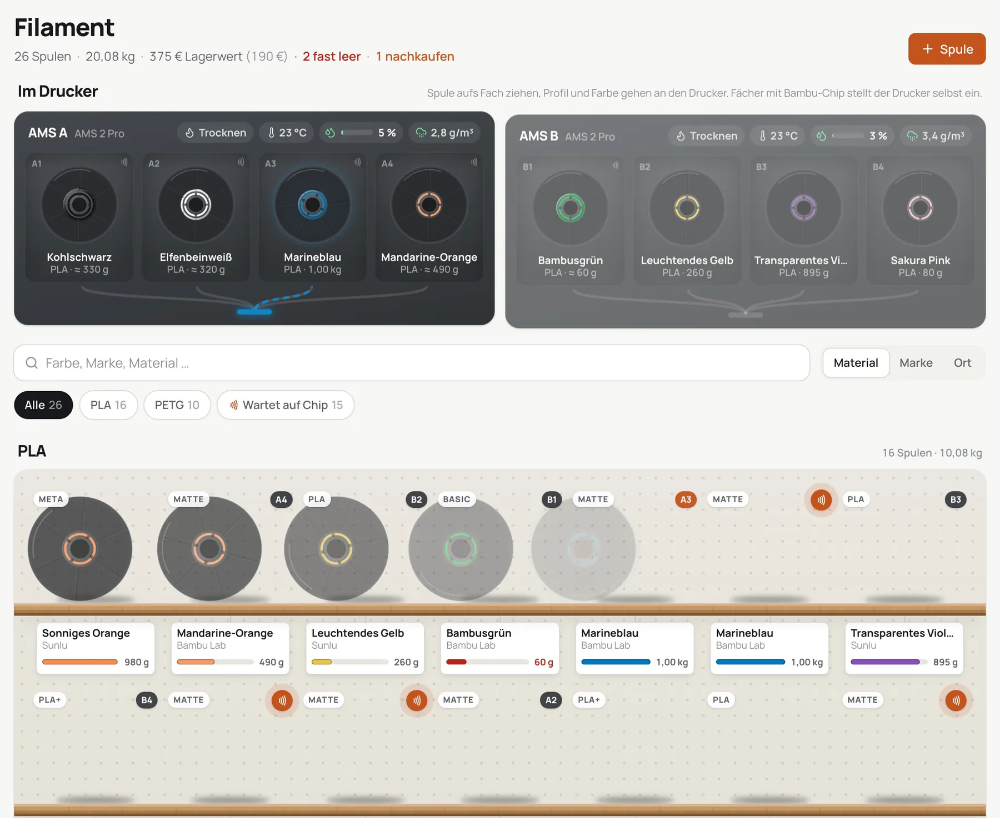</picture>

<picture><source media="(prefers-color-scheme: dark)" srcset="docs/images/drucker-dunkel.webp">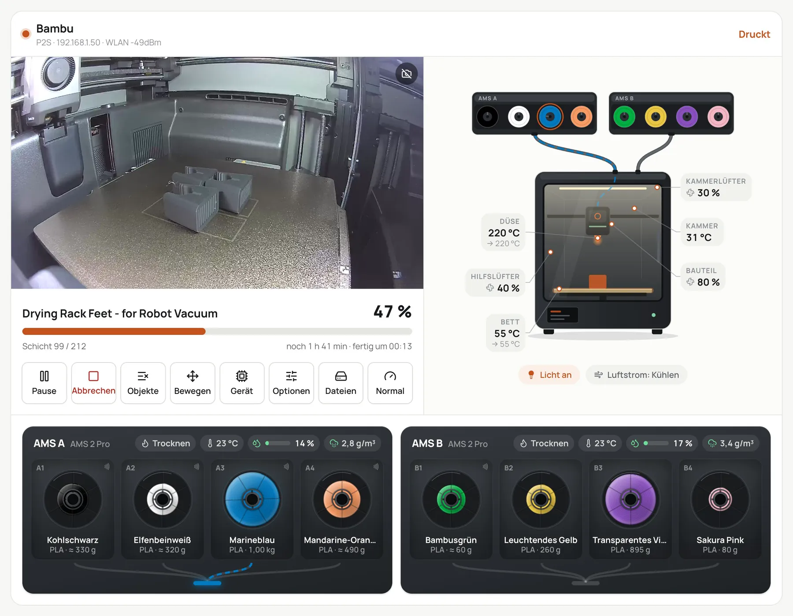</picture>

</div>

Every spool you own stands on a shelf, with the AMS right above it. Bambu spools sign themselves in by RFID, every print
books its grams off the spool that was really in the slot, and loading a spool is a drag onto the slot. You always know
what is left, what it cost and what to reorder, without a spreadsheet and without the cloud.

Around it, Druckwerk is the rest of your print setup: a library for your models with a 3D preview, print start straight on
the printer, slicing in the app with the official Bambu profiles, live status with camera and a history with a photo of every
plate. Bambu Studio stays for fine-tuning. Nothing
leaves your network.

> The user interface is in German. This README is available in English; German terms from the app are given in quotes
> where they help you find your way.

## Contents

- [Highlights](#-highlights)
- [Features](#-features)
- [Printers and integrations](#-printers-and-integrations)
- [Under the hood](#-under-the-hood)
- [Quick start](#-quick-start)
- [Configuration](#%EF%B8%8F-configuration)
- [Backup](#-backup)
- [Development](#-development)
- [Privacy](#-privacy)
- [License](#-license)

## ✨ Highlights

- 🧵 **A filament shelf that keeps itself up to date**: every spool on wooden boards, with fill level, price and stock value
- 🏷️ **Bambu spools sign themselves in**: RFID read in the AMS, spool created with the official colour name. Spools from an
  order wait in their vacuum bag until their chip shows up
- ⚖️ **Every gram booked**: usage per print from the slice, off the spool that was in the slot, even for prints started from
  Bambu Studio
- 🖱️ **Drag a spool onto an AMS slot**: profile, colour and nozzle temperatures go to the printer
- 🎨 **Colour catalogue** for Bambu Lab, Sunlu, eSUN, Polymaker, Prusament, Extrudr, Elegoo and more, and link import from any shop page
- 📡 **Your printer, live and in hand**: a drawing of the printer with temperatures, fans and airflow at the parts, camera,
  pause, stop, light, speed, heating, moving the axes, print options and AI detection, straight over the LAN
- 💧 **AMS under control**: load, unload, re-read the chip, dry with temperature and time, or dry automatically when the
  humidity climbs
- 🔪 **Slicing in the app** with Bambu Studio and the official profiles: pick the purpose, quality, nozzle, walls, infill and
  copies, see grams per spool and print time live before you print
- 📚 **A library for every model**: STL, 3MF, OBJ, STEP and sliced `.gcode.3mf` with a 3D preview, plus **Printables and
  MakerWorld** tabs to search and print right away
- ▶️ **Print in one click**: pick a plate, map filaments to AMS slots, start
- 📋 **Print queue**: line up sliced plates; when a print ends you get a message to clear the bed, the next one starts from the
  usual print dialog with fresh AMS mapping
- 📸 **A history that writes itself**: every print with a photo of the plate, filament used, stars and notes
- 🛟 **Every error code explained**: about 1,900 HMS messages and 480 print errors, in German, offline
- 💶 **What a print really cost**: filament off the spool plus power, measured by a Shelly or Tasmota plug or estimated
- 🔔 **Notifications** over ntfy, Gotify or a webhook (Home Assistant): print done with a photo, errors, spool almost empty,
  damp AMS, maintenance due
- 🗂️ **Every print archived**: files of prints started in Bambu Studio land in the library, with "print again" and the timelapse
- 🌗 **Light and dark**, from iPhone to 16" MacBook
- 🔒 **Everything stays with you**: one container, one SQLite file, one data folder

## 🧩 Features

### Filament shelf
The heart of the app. Spools roll onto the shelf, lift and turn when you hover over them, and the spool printing right now
spins in its AMS slot while the filament runs to the printer.

- All spools on wooden shelves, grouped by material, brand or location, with fill level, price and stock value
- The AMS slots sit on top: **drag a spool onto a slot** to load it, the profile, colour and nozzle temperatures go to the
  printer. Dropping onto a taken slot swaps. On touch screens a long press starts the drag
- **Bambu spools with RFID** are added automatically when loaded, with the official colour name. Spools you add ahead of time
  from an order wait in their vacuum bag ("Wartet auf Chip") and take over the chip the first time it is read
- **Fill level**: RFID spools follow the AMS, every print books its filament from the grams per filament in the slice,
  cancelled prints by progress. This also works for prints started from Bambu Studio
- **Third-party spools** get a starting value (grams or full, ¾, ½, ¼) and can be weighed on a kitchen scale
- **Print profiles** are picked to match material and type (Matte, Silk, CF …), also for third-party filament

| Light | Dark |
|---|---|
| 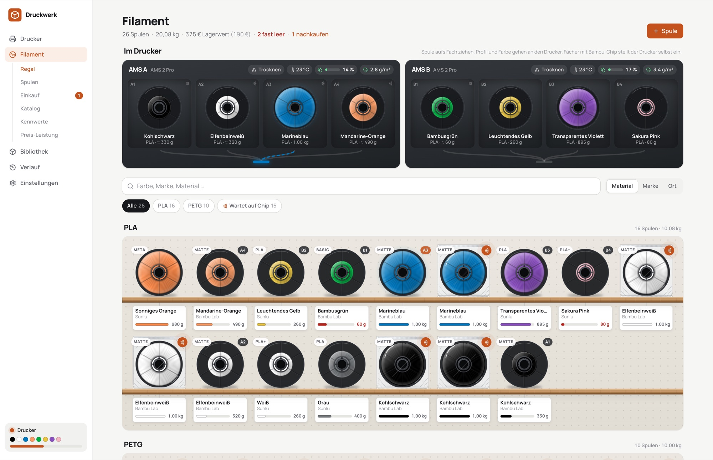 | 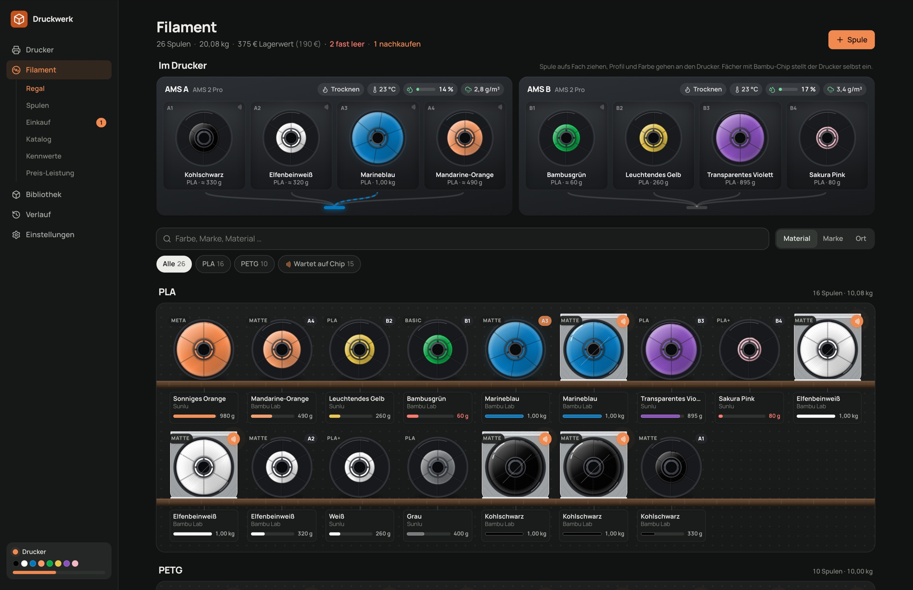 |

### Spools
- Brand, type, colour from the catalogue, weights, prices with discount, print profile with temperatures and drying
- **Link import**: paste a product link, the Anthropic API reads the shop page and fills in everything (optional, own API key)
- The spool list ("Spulen") shows every spool as a table: hex, profile, nozzle, location, RFID state, price per kilo, last
  used and remaining, sortable, with fewer columns on narrow screens

| Spool dialog | Spool list |
|---|---|
| 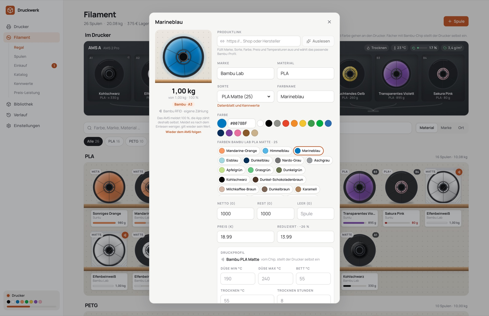 | 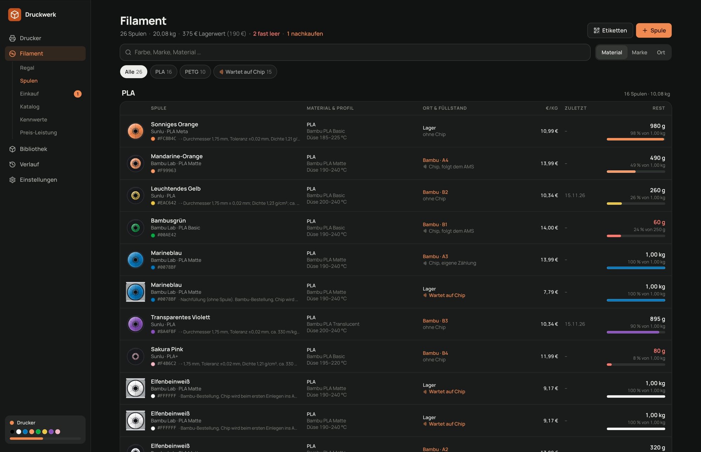 |

### Colour catalogue
- Every type and colour from **Bambu Lab** (from Bambu Studio, with German names and chip codes), **Sunlu** and **eSUN** (from their
  colour tables), plus **Polymaker**, **Prusament**, **Extrudr**, **Elegoo**, **Anycubic**, **Overture**, **Das Filament** and
  **3DJake** from [SpoolmanDB](https://github.com/Donkie/SpoolmanDB)
- Search across all colours, hex codes and manufacturer codes
- Only colours with a documented hex value; a few were looked up one by one in the manufacturers' colour tables, the rest are left out
  instead of being guessed. Add and edit your own brands, types and colours. Each brand card links to its shop

| Light | Dark |
|---|---|
| 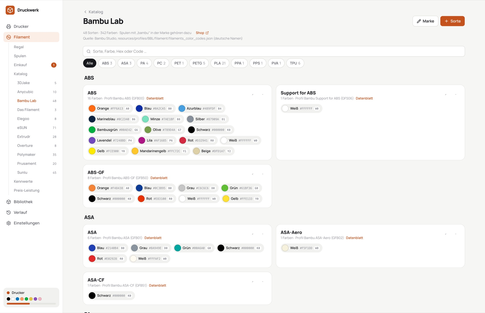 | 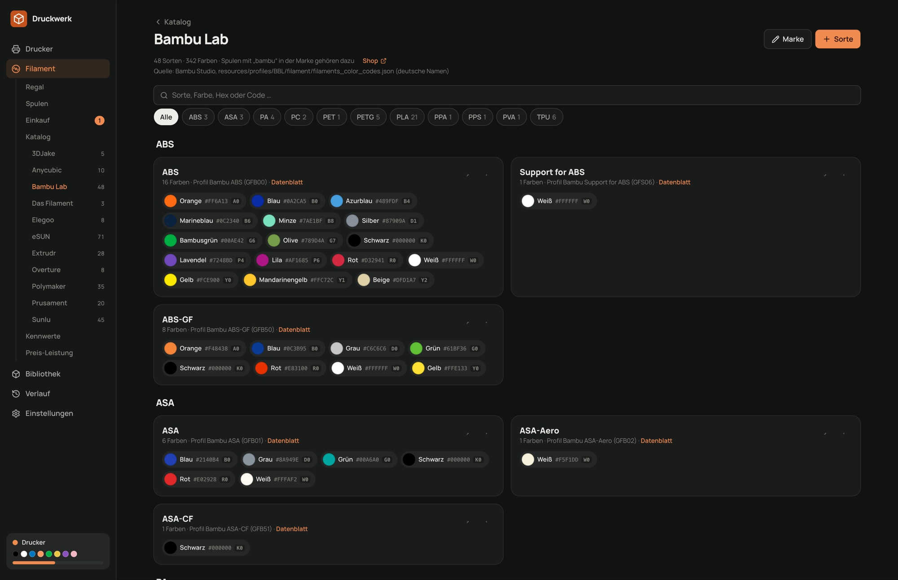 |

### Price per kg
- Shop prices of the common types (PLA, PLA+/Pro, Matte, Silk, High Speed, PETG) from the manufacturers' official shops for Germany,
  looked up once and stored with the date
- Per group a price scale and a ranking per kg, next to tensile strength and heat deflection from the datasheet; your own types
  on top with their rank, the cheapest alternative and what you paid

### Material data
- A datasheet page for almost every catalogue type, taken from the manufacturer's technical datasheet (linked): heat deflection
  (HDT at 0.45 and 1.8 MPa), Vicat, glass transition and melting point on a temperature scale next to nozzle, bed and drying
  temperatures, tensile, flexural and impact tests as small drawings, density, hardness and melt flow, each with its test standard
- Only values measured on printed test specimens, so types compare fairly (injection-moulded bars come out 20–50 % higher).
  Each value is ranked within its material and across all types
- Material pages (PLA, PETG, PA, …) show medians and ranges, a comparison page ranks all types and materials per property,
  optionally only the ones on your shelf. Spool dialog and catalogue link to the datasheet

| Price per kg | Material data |
|---|---|
| 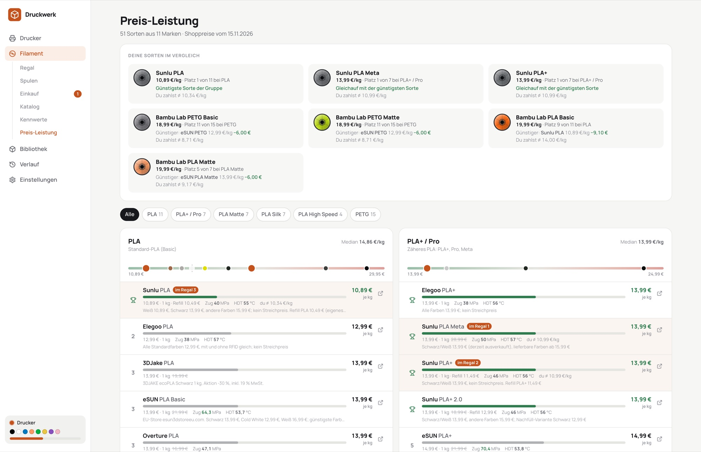 | 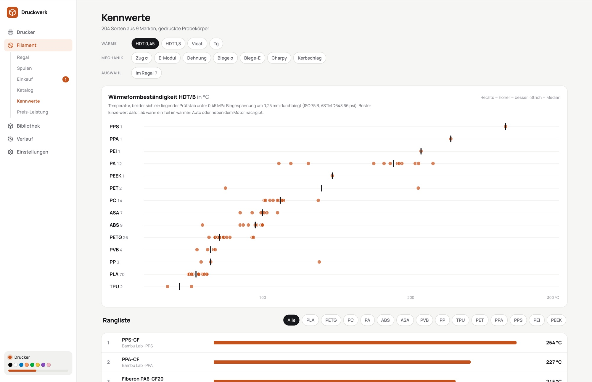 |

### Printer dashboard
- Status, progress, layer, time left and finishing time, nozzle, bed and chamber temperatures
- **A drawing of your printer** (P2S): print head moving, the object growing, nozzle, bed, chamber and every fan as a label
  right at the part, light and airflow. All AMS units sit on top with their own tube, the active slot colours tube and
  filament all the way into the print head
- **Live camera** (A1, P1 over TLS, X1, H2 and P2S over RTSPS)
- **Pause, resume, stop**, switch the light, pick the speed ("leise", "normal", "Sport", "rasend"), **skip objects** of the
  running print on a picture of the plate
- **Heat** nozzle and bed, set **fans** and **airflow** (cooling, heating, full cooling), **move** the axes, home and extrude
- **Print options and AI detection** (spaghetti, purge chute, nozzle clumping, first layer, build plate, foreign objects,
  door open during the print …), only what your printer reports
- **Device**: firmware of every module, nozzle diameter and type, storage; start bed levelling, vibration or motor noise
  calibration
- **Files on the SD card or USB stick**: list, print, take into the library or delete
- Printer problems (HMS) appear in German with a link to the Bambu wiki; acknowledge print errors, hide HMS messages until the
  printer drops them. Times of messages are converted even when the printer clock runs in the wrong time zone
- **AMS units as they stand in the printer**: humidity (relative and absolute in g/m³ with a scale) and temperature per unit,
  every slot with colour, name and remaining filament. The active spool turns and the filament runs to the printer
- **Load, unload, re-read the chip, dry** with temperature and time. Auto-drying starts when the humidity climbs above a limit,
  never during a print, and checks that the AMS really dries. AMS settings (read chips on insert or power-on, estimate
  remaining filament) and automatic spool switching

| Moving the axes | Print options |
|---|---|
| 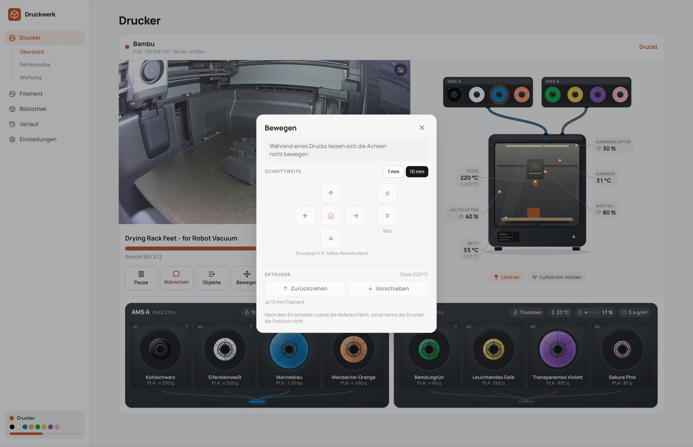 | 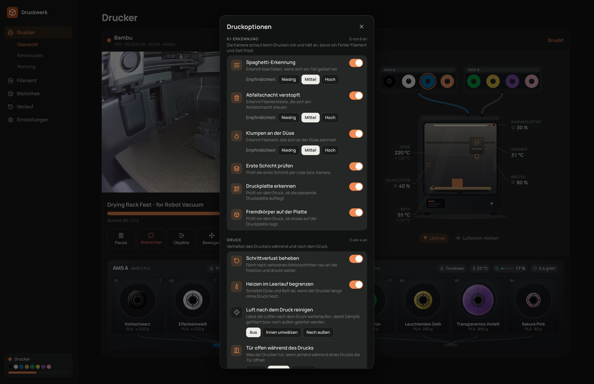 |

### Model library
- Models with any number of files: STL, 3MF, OBJ, STEP, sliced `.gcode.3mf`, images and more
- **Drop files onto the page**, every ZIP becomes its own model
- Thumbnails are rendered by the browser itself, sliced files bring their plate images
- Tags, favourites, search and a "ready to print" ("druckbereit") filter
- Model page with a **rotatable 3D preview** and dimensions, all files, description, source, licence and every print of this model
- Sliced files show print time, weight and filaments per plate. "In Bambu Studio öffnen" hands a file over for slicing

| Library | Model |
|---|---|
| 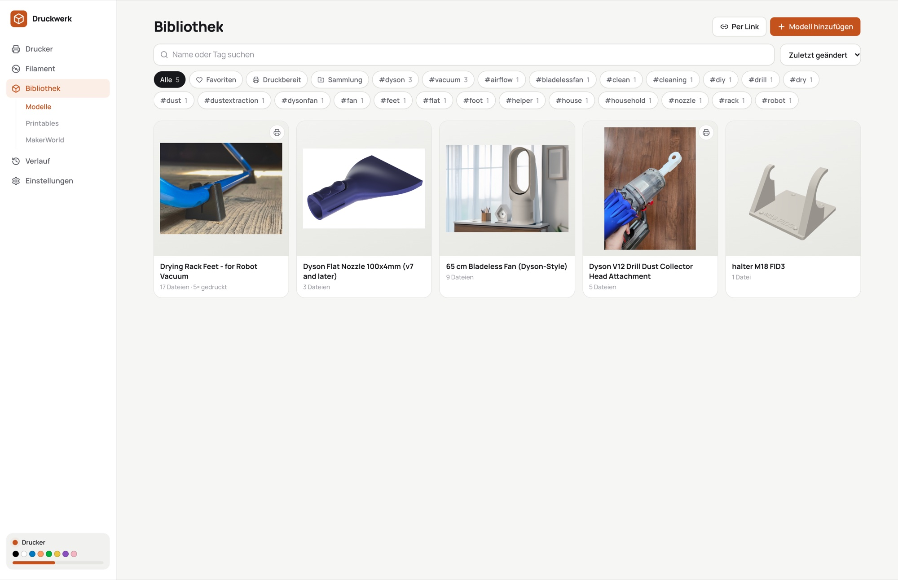 | 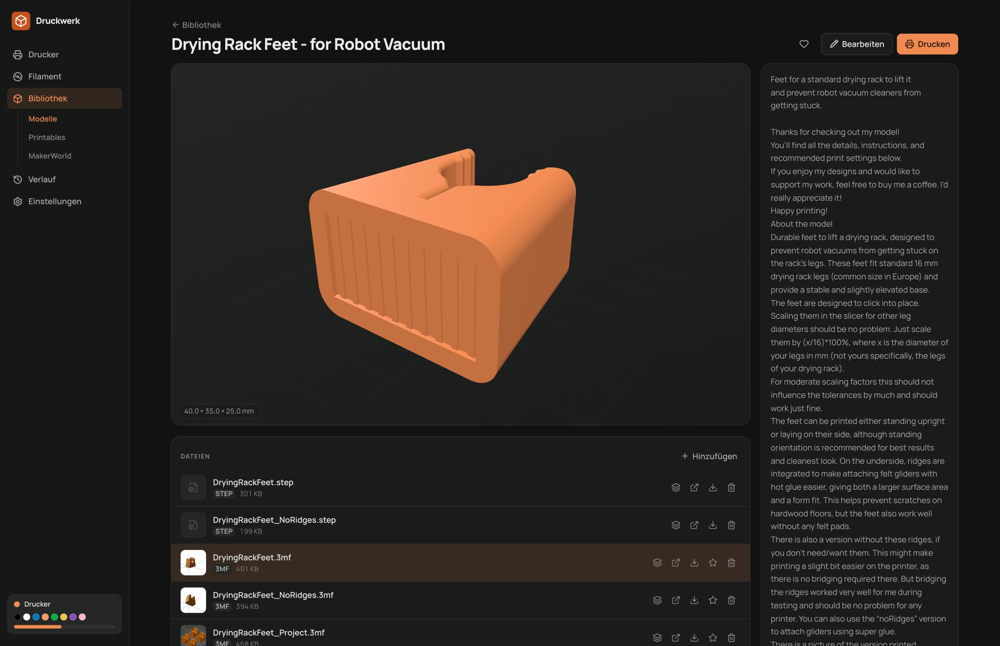 |

- **Collections** ("Sammlungen") group models into projects, a model can sit in several
- **Import by link**: a Printables link brings name, description, designer, licence, every file and the pictures, no account
  needed. A MakerWorld link brings details and pictures, and with a Bambu account signed in the 3MF of the default profile.
  Other sites bring details and pictures through the Anthropic API, you drop the files in yourself. Designer, licence and
  title are then read from the 3MF itself
- A link that is already in the library opens the existing model instead of a copy
- **Printables tab** next to the library: search and sort Printables, look at pictures and files, **print a model in two taps**
  like in Bambu Handy (it lands in the library, gets sliced on the server, then the print dialog opens), open a file straight
  in OrcaSlicer, download it (Bambu Studio only accepts links from MakerWorld) or take the whole model into the library
- **MakerWorld tab**: search MakerWorld, see every print profile with printer, time, grams and filament colours (profiles
  for your own printer first), print a profile or put its 3MF into the library. Searching works without an account, the
  files need a one-time sign-in with your Bambu account (e-mail and password or a code by mail; only the token is kept)

### Printing
- Sliced `.gcode.3mf` files start right from the app
- **Slicing in the app** ("Slicen und drucken") for STL, 3MF, OBJ and STEP: the server slices with the command line of
  Bambu Studio (open source, on ARM OrcaSlicer) and the official Bambu Lab profiles of your printer and nozzle. Pick quality, build plate, filament per AMS slot
  (profile and colour from the slot), supports (off, normal, tree), infill, brim, auto-orient and, with several colours, how much to purge
  at each colour change (100 % as in Bambu Studio, 75 % or 50 %); a 3MF keeps its objects
  and colours. **Several copies** at once: the slicer arranges them on the bed. The preview shows the model on your build plate (textured PEI,
  smooth PEI and so on) exactly where the slicer placed it. The sliced file is stored with the model and goes straight into the print dialog. Needs `SLICER=1`
- **Help on every choice**, each with a small drawing: purpose (functional part, visual part, fast) sets layer height, walls and
  infill to match the nozzle; nozzle with the one actually installed and a warning for CF/GF without a hardened nozzle; walls,
  supports, infill pattern seen from above
- **Live preview**: shortly after every change the server slices in the background and shows grams per spool with what is
  left afterwards and the print time, plus the difference to the default profile ("+13 min +5.4 g")
- **Projects with plates** (Bambu Studio, MakerWorld): pick one plate or all, the author's layout stays. Projects made for a
  bigger bed (H2S on a P2S) are moved onto your bed plate by plate
- Pick a plate, **map filaments to AMS slots** by clicking the spools in the AMS boxes (pre-filled by material and colour),
  timelapse, bed levelling and flow calibration as off, auto or always like Bambu Studio, with a drawing and a recommendation
- The file goes to the printer's SD card or USB stick over FTPS
- **Print queue**: line up sliced plates for one printer or the first free one, reorder them, start each from the print dialog
  with fresh AMS mapping. No auto start: when a print ends you get a message to clear the bed first
- **"In Orca öffnen"** hands any file to OrcaSlicer on your computer for everything the dialog does not cover

| Slicing | Print dialog |
|---|---|
| 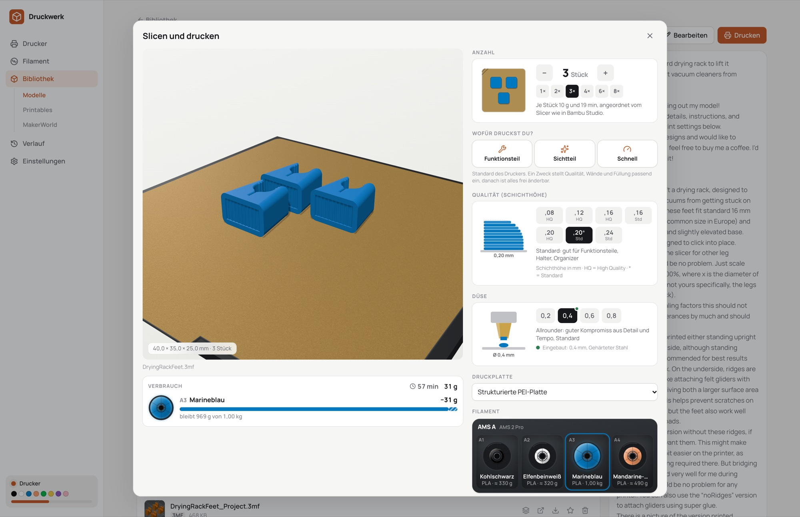 | 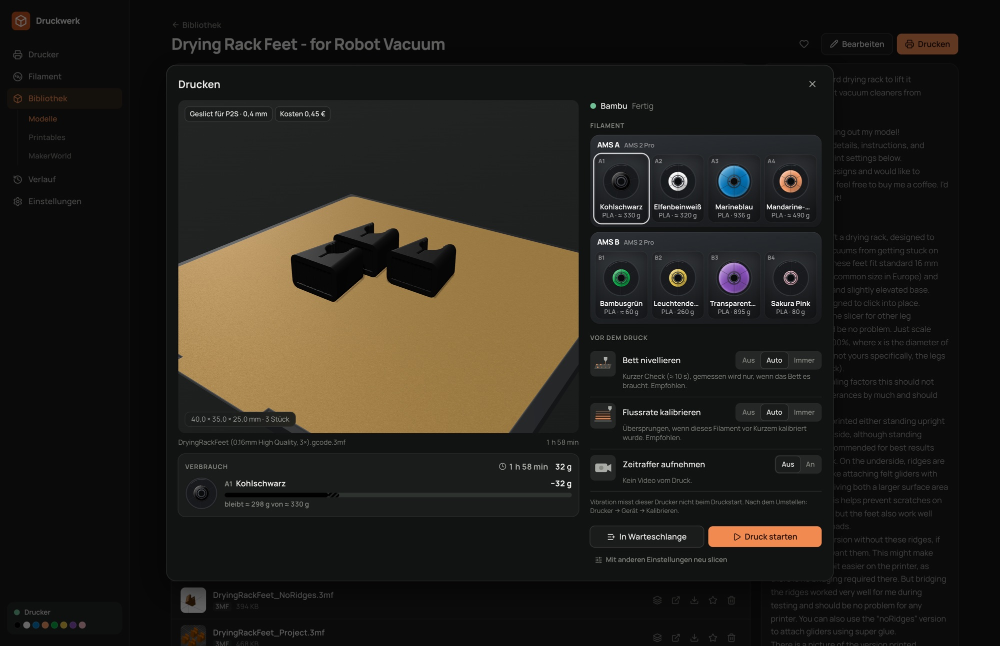 |

### History
- Every print is recorded automatically, also from Bambu Studio or the printer itself, and matched to its model
- A **photo of the plate** at the end of every print
- Stars and a note per print, errors with code and plain text
- Count, print time and success rate at the top
- Prints without a readable file (a P2S without SD card or USB stick, cloud prints) get **"Verbrauch nachtragen"**: book the
  grams by hand per spool or read them from an exported `.gcode.3mf`

| Light | Dark |
|---|---|
| 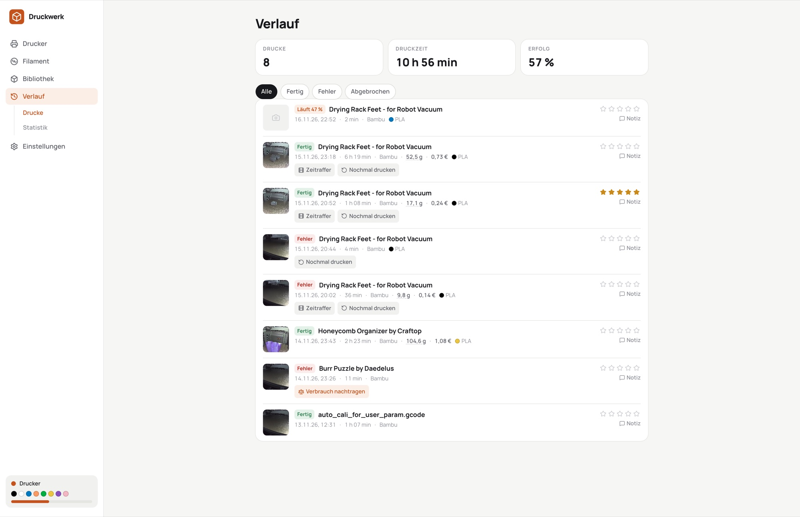 | 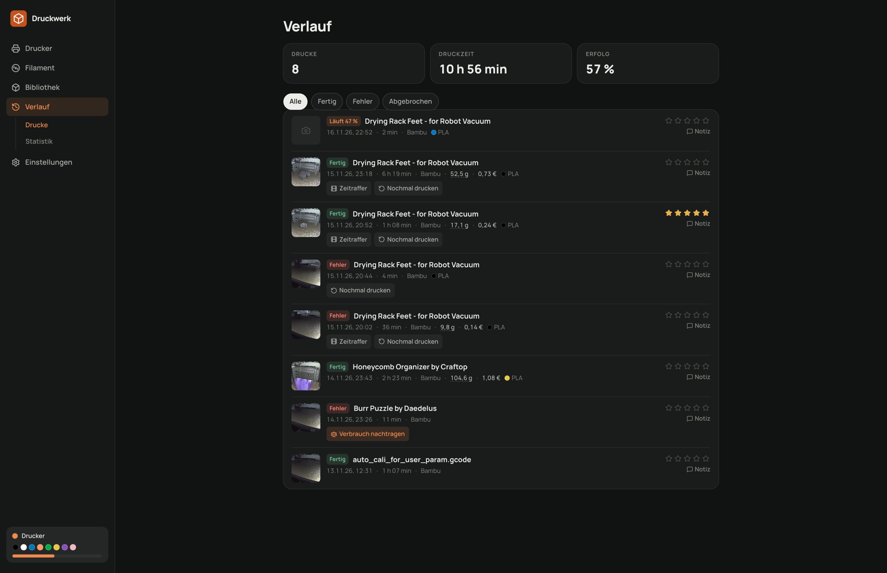 |

### Statistics
- Per month: prints, outcome, print time, filament by material, filament and power cost, as charts and a table
- Range from three months to everything

### Archive and timelapse
- Prints started in Bambu Studio or on the printer: the app fetches the `.gcode.3mf` from the SD card and files it as a model
  (tag "Archiv"), the same file only once
- **"Nochmal drucken"** in the history opens the print dialog with the same plate
- **Timelapse** videos are fetched from the printer after each print and play right in the history (AVI is converted to MP4
  with ffmpeg)

### Maintenance
- Maintenance items per printer, due after print hours (from the history plus the hours before Druckwerk) or after days
- Progress per item, "Erledigt" resets it. Suggestions with typical intervals to start from
- Due items show on the printer dashboard and can be sent as a notification

| Statistics | Maintenance |
|---|---|
| 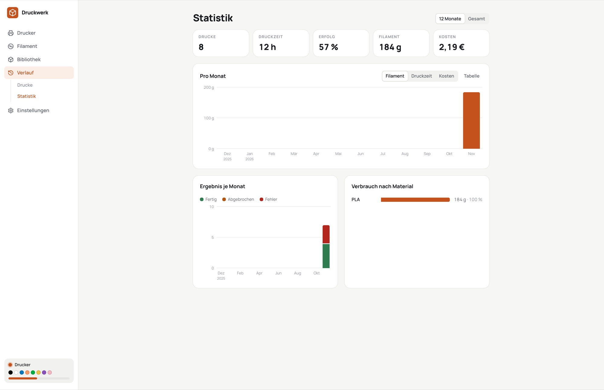 | 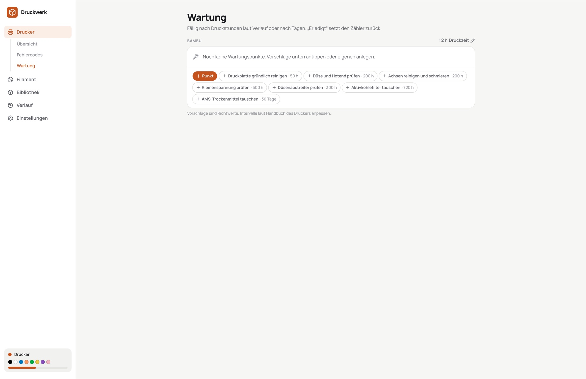 |

### Costs, stock and labels
- Cost per print from the spool price and power: a **Shelly or Tasmota plug** per printer measures the energy, otherwise
  wattage × time
- **Will the spool last?** The print dialog compares the grams of the plate with what is left on the mapped spool
- **Minimum stock** per brand, line, material or colour (a base colour counts its whole family), with a **shopping list**:
  every shop you bought a matching spool from, with the last price and the cheapest per kg marked
- **QR labels** for spools (50 × 30, 62 × 29 mm or A4 sheets): scanning with the iPhone camera opens the spool in the app

### Notifications
- ntfy (photo as attachment), Gotify (Markdown with photo) and webhook (JSON, e.g. for Home Assistant), all optional
- Print done or failed, printer errors (HMS), spool almost empty, AMS humidity above a limit, auto-drying, next print in the
  queue, maintenance due
- A test button in the settings sends one message per channel

### Error codes
- About 1,900 HMS messages and 480 print errors for all Bambu printers, in German
- Searchable, filtered by area, every code with a link to the Bambu wiki
- Many codes have no text and no wiki page at Bambu; then the message names the affected part (AMS unit, camera, system …)
- The list ships with the app, it never asks Bambu

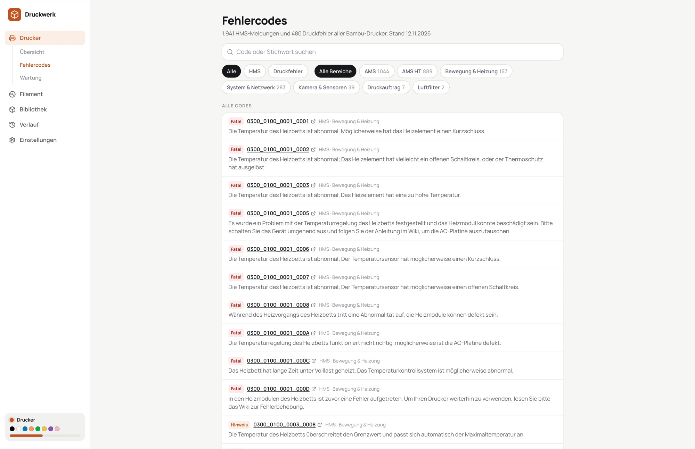

### Around the app
- **First steps** ("Erste Schritte"): a guided setup on first launch for printer, filament and link import, every step can be
  skipped
- **Settings** grouped by topic with a search across all fields, an explanation, default and where to find it for every field
- Built for the phone: tab bar at the bottom, tabs instead of the sidebar, spools dragged into slots with a long press
- **Dark mode** follows the system

| First steps | Settings |
|---|---|
| 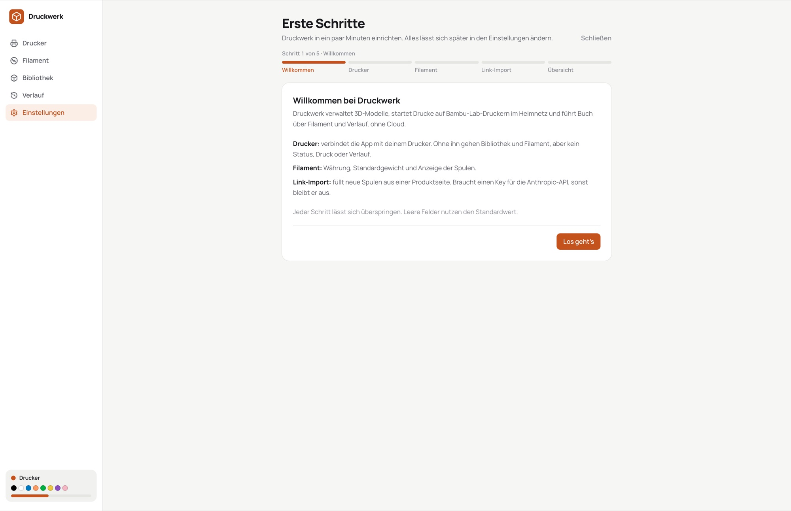 | 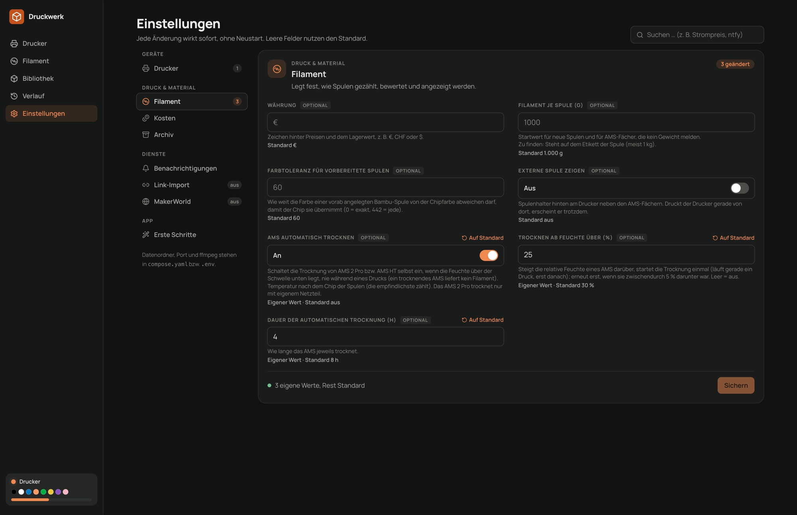 |

<p align="center">
  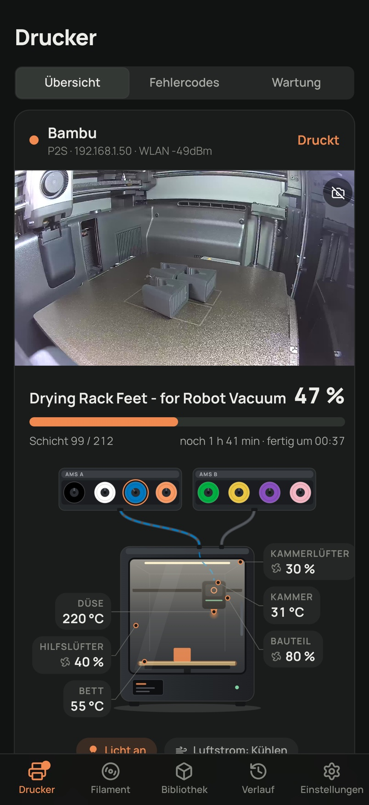
  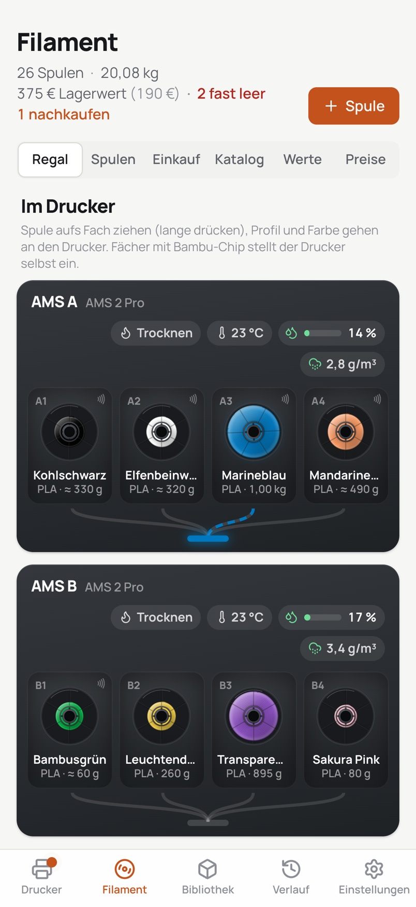
  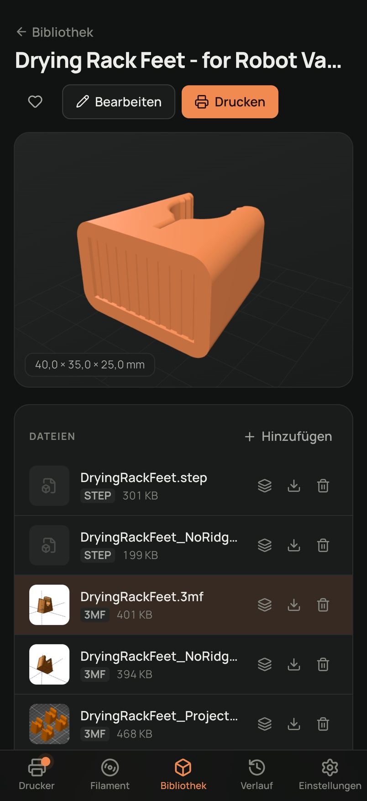
  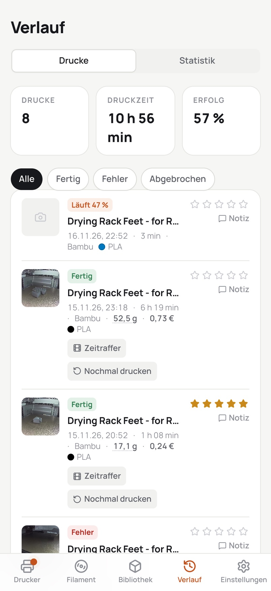
</p>

## 🔌 Printers and integrations

| What | What it brings | How |
|---|---|---|
| **Bambu Lab A1, A1 mini, P1P, P1S** | Status, commands, print start, camera over TLS | LAN mode on the printer, address, serial number, access code |
| **Bambu Lab P2S, X1 Carbon, X1E, H2D, H2S** | Status, commands, print start, camera over RTSPS | As above, plus LAN liveview on the printer and ffmpeg in the image |
| **AMS, AMS 2 Pro, AMS HT** | Slots, RFID spools, humidity, temperature, drying | Automatic with the printer |
| **Bambu Studio** | Prints started there show up in history and book their filament | Automatic, the app fetches the file from the printer |
| **Shelly, Tasmota** | Energy per print for the power cost | Plug address per printer in the settings |
| **ntfy, Gotify, webhook** | Notifications on your phone or into Home Assistant | URLs and tokens in the settings |
| **Printables** | Search, print in the app, open in OrcaSlicer, import a model with files and pictures | Nothing, uses the public API |
| **MakerWorld** | Search, print profiles, print in the app, import a model with pictures and the 3MF of a profile | Searching: nothing. Files: sign in with your Bambu account in the settings |
| **Bambu Studio (Linux)** | Slicing in the app with the official Bambu Lab printer, process and filament profiles (OrcaSlicer on ARM) | Build argument `SLICER=1`, or `SLICER_BIN` |
| **Anthropic API** | Link import: fill in a spool from a shop page, details of a model from other sites | API key in the settings, model selectable |

Printing from the app needs **developer mode** on the printer (firmware with authorization control only accepts commands
from other apps in LAN mode with developer mode) and an SD card or USB stick. Without developer mode, status, camera, light and
history still work.

## 🔬 Under the hood

What happens in the background so the front feels simple.

### Printer connection
- **MQTT over TLS** (8883) for status and commands. Reports are deltas: merged deeply, arrays replaced, replies to
  commands kept apart from status reports
- **FTPS** (implicit, 990) for uploading and for reading back files of prints started elsewhere
- **Camera**: A1 and P1 send JPEG frames over TLS on 6000, X1, H2 and P2S stream RTSPS on 322 through ffmpeg. Output as MJPEG,
  one connection per printer, closed 5 s after the last viewer
- The history is built from changes of the print state; cancelled and failed prints are told apart by their error code

### Filament tracking
- After every report with changed slots, the app syncs the AMS: a new chip first takes over a spool you prepared
  (same profile, similar colour, oldest first), otherwise a new Bambu spool is created
- **Usage per print** from `slice_info.config` of the plate: grams per filament × progress, booked once per print to the
  spool that was in the slot at start. Without slice info, the drop in the RFID fill level × spool weight
- Once a spool is weighed or corrected by hand, only print bookings count from then on

### Models and files
- Uploads are streamed to disk with a sha256 on the way, ZIPs are unpacked
- **3MF parsing**: plates, filaments, print time and printer from the slice info, plate images straight from the file
- **Thumbnails** for STL, OBJ and 3MF are rendered in the browser with three.js (Z-up turned to Y-up, set onto the bed)
  and uploaded to the server

### Data
- **SQLite via `node:sqlite`**, no native dependency. Migrations tracked in `user_version`
- **Settings** with a clear order: value in the app, else environment, else built-in default. Read on every access, so changes
  apply at once
- The printer's access code and the API key never leave the server; the UI only shows a hint such as `…abcd`

## 🚀 Quick start

### Docker

```bash
git clone https://github.com/Yatheria030/druckwerk.git
cd druckwerk
mkdir -p data
docker compose up -d --build
```

Then open http://localhost:8795. `compose.yaml` stores the database, model files, thumbnails and photos in `./data`
and builds the image with ffmpeg for the camera of X1, H2 and P2S and with Bambu Studio for slicing in the app
(`SLICER: "1"`; Bambu Studio on amd64, OrcaSlicer on arm64 where Bambu Studio has no Linux build; set it to `"0"` if you only slice on your computer).

### Node

Requires Node 24.

```bash
npm ci
npm run build
npm start
```

On first launch, **first steps** ("Erste Schritte") opens. Nothing is required: library and filament work without a printer.
Before connecting a printer, switch on **LAN mode** on the printer, and **developer mode** to print from the app.

## ⚙️ Configuration

All values live in the app's settings and are stored in the database. An empty field means default. Environment variables
only apply as long as nothing is set in the app.

| Value | Required? | Default | Environment | In the app |
|---|---|---|---|---|
| Printer: name | for the printer | – | `BAMBU_NAME` (default "Drucker") | Settings → printer, setup step 2 |
| Printer: model | for the printer | P2S | `BAMBU_MODEL` | Settings → printer, setup step 2 |
| Printer: IP address | for the printer | – | `BAMBU_HOST` | On the printer: settings → Wi-Fi or network |
| Printer: serial number | for the printer | – | `BAMBU_SERIAL` | On the printer: settings → device, or Bambu Studio |
| Printer: access code | for the printer | – | `BAMBU_ACCESS_CODE` | On the printer, shown with LAN mode |
| Currency | optional | € | – | Settings → filament |
| Filament per spool | optional | 1000 g | – | Settings → filament |
| Colour tolerance for prepared spools | optional | 60 (0–442) | – | Settings → filament |
| Show external spool | optional | off | – | Settings → filament |
| Dry AMS automatically | optional | off | – | Settings → filament |
| Auto-dry above humidity, for how long | optional | 30 %, 8 h | – | Settings → filament |
| Power price | optional | – (no power cost) | – | Settings → costs |
| Wattage without a plug | optional | – | – | Settings → costs |
| Archive prints from Bambu Studio | optional | on | – | Settings → archive |
| Fetch timelapse | optional | on | – | Settings → archive |
| ntfy topic and token | optional | – | – | Settings → notifications |
| Gotify server and app token | optional | – | – | Settings → notifications |
| Webhook | optional | – | – | Settings → notifications |
| Address of Druckwerk (links and photos in messages) | optional | – | – | Settings → notifications |
| Notify on print done, failed, HMS, auto-drying, queue, maintenance | optional | on | – | Settings → notifications |
| Spool almost empty below | optional | 100 g (0 = off) | – | Settings → notifications |
| AMS humidity above | optional | – (off) | – | Settings → notifications |
| API key for the link import | optional | – (import off) | `ANTHROPIC_API_KEY` | Settings → link import (Anthropic API) |
| Model for the link import | optional | `claude-opus-5-5` | `SCRAPE_MODEL` | Settings → link import (Anthropic API) |
| Bambu account for MakerWorld files | optional | – | – | Settings → MakerWorld (only the token is stored) |

The printer is only needed for status, printing, camera and history. The `BAMBU_*` variables create the printer once at
start if its serial number is not known yet. Template for all variables: [`.env.example`](.env.example).

Environment only, because they must be known before the database:

| Variable | Default | Purpose |
|---|---|---|
| `DATA_DIR` | `data` (in the image `/data`) | Database, model files, thumbnails, print photos |
| `PORT` | `8795` | Port for API and UI |
| `HOST` | `127.0.0.1` (in the image `0.0.0.0`) | Address the server listens on |
| `FFMPEG` (build argument) | `0` | `1` installs ffmpeg for the camera of X1, H2 and P2S |
| `SLICER` (build argument) | `0` | `1` installs the Bambu Studio command line (OrcaSlicer on arm64) with the Bambu Lab profiles for slicing in the app. An AppImage placed in `vendor/` is used instead of downloading it |
| `SLICER_BIN` | found automatically | Path to the Bambu Studio or OrcaSlicer binary when it is installed elsewhere (Bambu Studio is preferred) |

### Network

The app talks to the printer directly: MQTT TLS (8883), FTPS (990 plus passive ports), camera on 6000 (A1, P1) or
RTSPS 322 (X1, H2, P2S). If the printer sits in another network, these ports must be reachable from the container.
Times are shown in the browser's time zone. Many printers in LAN mode keep their clock in the wrong zone (a P2S never paired
with the phone app runs on UTC+8); Druckwerk learns the offset from timelapses and new messages and marks converted times.

## 💾 Backup

Everything lives in the data folder (`DATA_DIR`, with Docker `./data`): `stl.db`, `files/`, `thumbs/` and `photos/`.
To back up, stop the container and copy the folder; to restore, put it back and start again.

## 🛠 Development

```bash
npm run dev:server
```

```bash
npm run dev:web
```

Vite runs on :5181 and forwards `/api` to the server on :8795. Check with `npm run typecheck`, build with
`npm run build` (into `dist/`, served by the server).

```
server/   Hono API, SQLite schema, uploads and 3MF parsing, printer connection, camera, filament, catalogue, link import;
          specs/ holds the datasheet values per brand
shared/   Types and logic for server and UI (settings, print profiles, colour names, catalogue)
web/      React UI: pages in pages/, components in ui/, three.js loading and thumbnails in lib/three.ts
scripts/  Refresh the error codes and the colour catalogues (Sunlu, eSUN, SpoolmanDB)
docs/     Screenshots
```

**Stack**: Hono on Node 24 (runs straight from TypeScript via tsx), `node:sqlite`, React 19, Vite, Tailwind CSS 4,
TanStack Query, three.js.

The screenshots show a simulated printer with a sample address and serial number.

## 🔒 Privacy

One container, one SQLite file, one data folder. No Bambu cloud for the printer, no tracking, no telemetry. The app talks to
the printer directly on your network. Only what you use yourself leaves it: the Printables and MakerWorld tabs, the MakerWorld
sign-in (only for its files) and the link import once you enter an API key.

Druckwerk is a private project and not affiliated with Bambu Lab. Bambu Lab, AMS and Bambu Studio are trademarks of their
owners. The printer protocol fields are not officially documented and may change with new firmware.

## 📄 License

[MIT](LICENSE)
